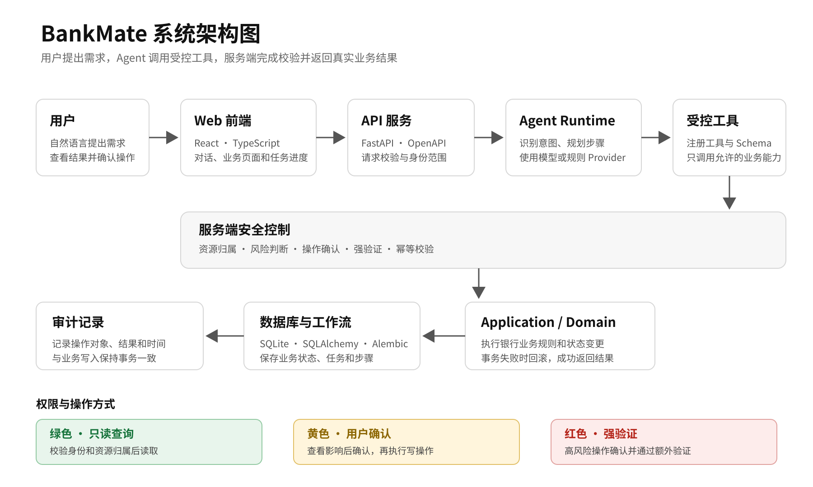

<p align="center">
  
</p>

<h1 align="center">BankMate</h1>

<p align="center">
  用日常语言管理账户、账单与资金安排
</p>

<p align="center">
  React · TypeScript · FastAPI · SQLite
</p>

<p align="center">
  <a href="#产品能力">产品能力</a> ·
  <a href="#操作如何完成">操作流程</a> ·
  <a href="#本地运行">本地运行</a> ·
  <a href="#项目资料">项目资料</a>
</p>

BankMate 将账户查询和常见银行事务放在同一处。用户可以查看资金情况、提出办理需求、核对操作影响，并从页面查看服务端返回的处理结果。

## 产品能力

| 场景           | 可以办理的事情                                       |
| -------------- | ---------------------------------------------------- |
| **账单分析**   | 查看收支、分类、年度账单和需要核对的交易。           |
| **银行卡**     | 申请、冻结或解冻、挂失补卡，并管理交易限额与限制。   |
| **转账**       | 管理收款人，办理转账、预约转账和 AA 分账。           |
| **订阅代扣**   | 查看周期扣费与续费时间，暂停、恢复或取消代扣。       |
| **理财**       | 了解产品与风险等级，查看持仓并办理模拟申购或赎回。   |
| **跨场景办理** | 将账单、订阅、银行卡、账户和理财信息组合成连续任务。 |

## 操作如何完成

**提出需求 → 查看方案 → 确认操作 → 查看结果**

- 查询前校验当前身份与数据归属。
- 资金或账户状态变更会先呈现操作对象和影响，再由用户确认。
- 高风险操作按服务端策略进行额外验证；业务结果和操作记录以服务端返回为准。

### 系统结构

<p align="center">
  
</p>

## 本地运行

当前数据为虚拟账户、交易和产品，不连接真实银行、支付网络或商户。默认使用本地规则处理请求；如需使用兼容模型服务，可在本机 `.env` 配置。密钥只交给 API 服务读取，不要放进网页配置或提交到仓库。

### Windows

需要 Node.js 24、pnpm 11、Python 3.13 和 uv。

```powershell
Copy-Item .env.example .env
pnpm install
uv sync --project apps/api
.\scripts\demo.ps1 -Mode reset
```

分别在两个终端启动：

```powershell
.\scripts\demo.ps1 -Mode api
```

```powershell
.\scripts\demo.ps1 -Mode web
```

### macOS / Linux

```bash
cp .env.example .env
pnpm install
uv sync --project apps/api
uv run --project apps/api alembic -c apps/api/alembic.ini upgrade head
uv run --project apps/api python -m finorch_api.reset --confirm
```

在两个终端分别运行：

```bash
uv run --project apps/api uvicorn --app-dir apps/api/src finorch_api.main:app --host 127.0.0.1 --port 8000
```

```bash
pnpm --filter @finorch/web exec vite --host 127.0.0.1
```

## 项目资料

- [作品简介](docs/submission/作品简介.md)
- [系统架构图](docs/submission/系统架构图.md)
- [核心算法说明](docs/submission/核心算法说明.md)
- [安全设计文档](docs/submission/安全设计文档.md)
- [安全自评报告](docs/submission/安全自评报告.md)
- [题目与评审要求对照](docs/submission/题目与评审要求对照.md)

## 许可证

[Apache License 2.0](LICENSE)
