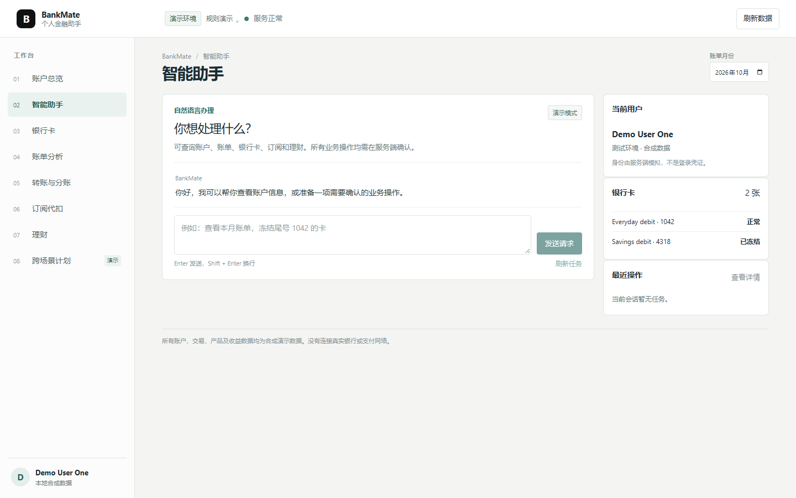
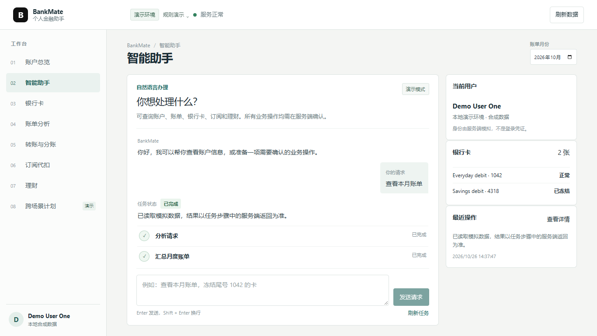
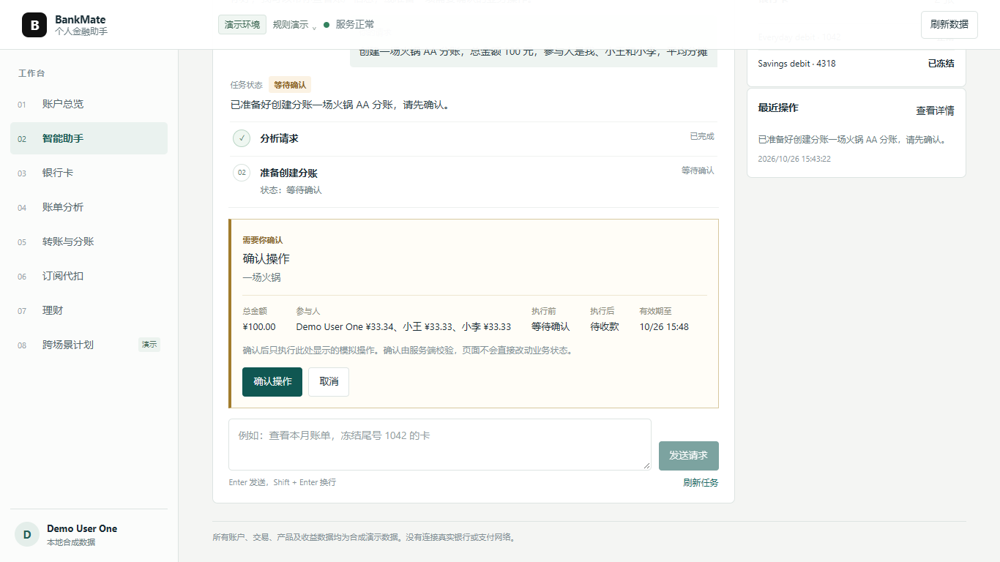
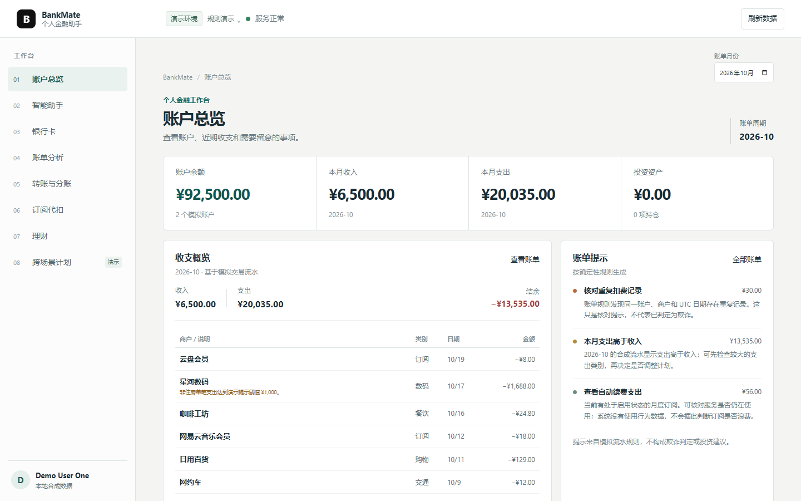
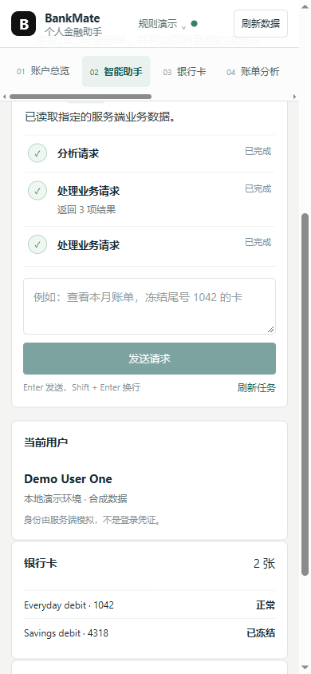
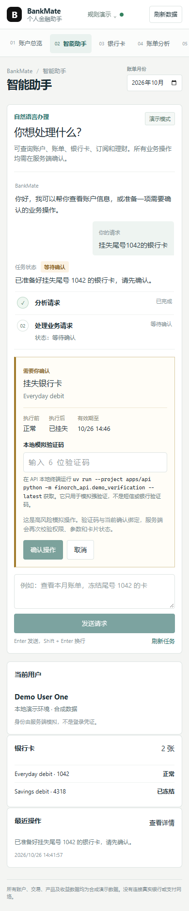
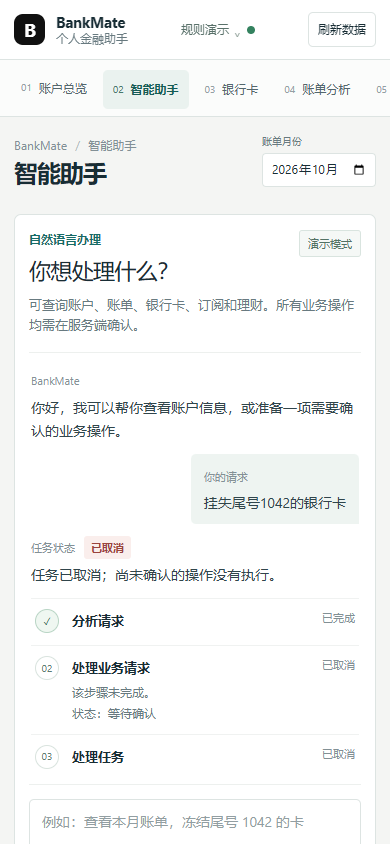

# BankMate Phase 3 功能与验收矩阵

本表区分“代码已实现”和“本轮已验收”。实现状态按当前分支代码判断；真实模型状态只引用已完成的 Phase 3 Final 报告。案例编号来自 `apps/api/scripts/phase3-final-dev-cases.json` 和冻结留出集，不代表这些案例以外的总体成功率。

| 子功能                            | API / Agent Tool                                                                                                                       | 前端入口                       | 服务端安全与真实结果                                                                        | 自动化证据                                                                        | DeepSeek 案例 / 验收                                       | 限制                                             |
| --------------------------------- | -------------------------------------------------------------------------------------------------------------------------------------- | ------------------------------ | ------------------------------------------------------------------------------------------- | --------------------------------------------------------------------------------- | ---------------------------------------------------------- | ------------------------------------------------ |
| 卡片查询、状态                    | `GET /api/v1/cards`、`GET /api/v1/cards/{id}`；`card.list/get`                                                                         | 助手、银行卡页                 | actor 归属过滤；返回数据库状态                                                              | `test_cards_api.py`、`test_cards.py`                                              | 开发集 `P3D-001`；独立集按冻结报告                         | Demo Identity 非生产认证                         |
| 模拟借记卡申请                    | `GET /api/v1/cards/applications`；`card.apply/applications`                                                                            | 助手/申请结果                  | 提交需要确认；本地模拟审核，不是银行发卡                                                    | `test_cards_api.py`、`test_agent_api.py`                                          | `P3D-002/003`                                              | 审核仅本地 operator CLI                          |
| 卡片限额与线上开关                | Task confirm；`card.controls`                                                                                                          | 助手确认卡                     | 写后消费路径实际检查单笔、日累计、线上开关、卡状态、可用余额；重大上调用 Demo OTP           | `test_card_controls.py`、`test_strong_verification.py`                            | `P3D-006/007/037`；红色 OTP 案例需检查报告字段             | 只影响固定模拟消费目录；不代表真实卡控           |
| 冻结与解冻                        | Task confirm；`card.freeze/unfreeze`                                                                                                   | 助手、银行卡页                 | 服务端确认、版本与归属复核、幂等、审计                                                      | `test_cards.py`、`test_agent_api.py`、`test_cross_scenario_workflows.py`          | 六场景类目；查看最终报告逐案                               | 挂失状态不可通过普通解冻恢复                     |
| 挂失与补卡                        | Task confirm；`card.report_lost/replace`                                                                                               | 助手、银行卡页                 | 确认 + Demo OTP；挂失旧卡保持不可用，补卡生成新卡并关联旧卡                                 | `test_cards.py`、`test_strong_verification.py`                                    | `P3D-004/005`                                              | 无实体制卡和真实风控审批                         |
| 固定目录模拟消费                  | Task confirm；`card.catalog/purchase`                                                                                                  | 助手                           | 卡状态、线上开关、单笔/日限额、可用余额在服务端事务内重核；交易与审计一致                   | `test_card_controls.py`、`test_cards.py`                                          | `P3D-008/009/010`                                          | 仅合成商品和本地账本                             |
| 月度账单与分类                    | `GET /api/v1/bills/summary`；`bill.monthly_summary`                                                                                    | 助手/账单展示                  | 服务端从合成流水汇总，整数分                                                                | `test_bills_subscriptions.py`                                                     | `P3D-011`                                                  | 仅模拟流水                                       |
| 交易筛选                          | `GET /api/v1/transactions`；`bill.transactions`                                                                                        | 助手/交易明细                  | actor、时间、类别、商户过滤                                                                 | `test_bills_subscriptions.py`                                                     | `P3D-012`                                                  | 前端不重算资金结果                               |
| 异常消费提示                      | 月度账单/Task；`bill.anomalies`                                                                                                        | 助手                           | 规则依据来自服务端；重复扣费按账户、商户、金额、币种、UTC 日匹配                            | `test_bills_subscriptions.py`、`test_cross_scenario_workflows.py`                 | `P3D-013/032`                                              | 规则提示不是欺诈识别                             |
| 年度账单                          | `GET /api/v1/bills/annual`；`bill.annual_report`                                                                                       | 助手/年度账单结果              | 年度收入、支出、月度分布、分类及规则提示由后端聚合                                          | `test_bills_subscriptions.py`                                                     | `P3D-014/016`                                              | 不含预测模型                                     |
| 订阅列表与周期识别                | `GET /api/v1/subscriptions`；`subscription.list`                                                                                       | 助手/订阅展示                  | 从合成交易识别；返回真实订阅状态和下次扣款                                                  | `test_bills_subscriptions.py`                                                     | `P3D-017`                                                  | 不连接商户                                       |
| 续费提醒及偏好                    | `GET /api/v1/subscriptions/reminders`、`POST .../refresh`、`PUT .../{id}/reminder-preference`；`subscription.reminders`                | 助手、订阅结果                 | 服务端按账期去重；开发环境 scheduler 重启后重新扫描                                         | `test_subscription_reminders.py`                                                  | `P3D-015/016`                                              | 应用内提示，不发送短信/商户通知                  |
| 暂停、恢复、取消续费              | Agent Task；`subscription.pause/resume/cancel`                                                                                         | 助手确认卡                     | actor/对象复核、用户确认、幂等和审计                                                        | `test_bills_subscriptions.py`、`test_agent_api.py`                                | `P3D-018/019/020`                                          | 仅变更模拟订阅状态                               |
| 风险问卷                          | `GET /api/v1/investments/risk-assessment/questionnaire`、`POST /api/v1/investments/risk-assessment`；`investment.assessment_questions` | 风险测评表单                   | 用户本人提交；Agent 不替答；服务端保存画像                                                  | `test_risk_assessment.py`                                                         | `P3D-021/022`                                              | 本地 Demo 问卷，不构成投资建议                   |
| 产品筛选与比较                    | `GET /api/v1/investments/products`；`investment.products/compare/profile`                                                              | 助手/产品比较                  | `suitable` 由后端按风险画像计算，结果为权威值                                               | `test_transfers_investments.py`、`test_risk_assessment.py`                        | `P3D-023/024/026`                                          | 产品与收益均为合成/说明性数据                    |
| 理财申购与赎回                    | Task confirm；`investment.buy/redeem`                                                                                                  | 助手确认卡、持仓/订单结果      | 申购重验产品适当性、余额、版本和幂等；写后更新余额、持仓、订单、交易/审计；R4/R5 申购需 OTP | `test_transfers_investments.py`、`test_strong_verification.py`                    | `P3D-025/026/027`；以报告检查实际确认与执行字段            | 不保证收益；非真实投资                           |
| 普通转账、手机号与备注            | `/api/v1/accounts`、`/api/v1/payees`、`/api/v1/transfers`；`transfer.accounts/payees/create/history`                                   | 助手确认卡、转账结果           | 姓名/手机号对应、金额与备注由服务端复核；幂等、余额/累计风险、确认和审计                    | `test_transfers_investments.py`、`test_risk_policy.py`                            | `P3D-028/029`                                              | 模拟账户之间记账                                 |
| 定时转账与执行/取消               | `POST /api/v1/simulate-due`、`GET /api/v1/transfers`；`transfer.schedule/simulate_due/cancel_scheduled`                                | 助手、转账历史                 | 创建须确认；执行日重验资金及风险；失败不产生虚假扣款                                        | `test_transfers_investments.py`、`test_risk_policy.py`                            | 与转账及跨场景样本共同覆盖                                 | 只提供本地模拟执行器                             |
| AA 分账与收款                     | `/api/v1/splits`；`transfer.split_create/splits/split_collect`                                                                         | 助手确认卡、AA 结果            | 标题、总额、参与人核对；逐项确认；模拟收款状态                                              | `test_transfers_investments.py`、`test_cross_scenario_workflows.py`               | `P3D-030`                                                  | 参与人结算不发起真实支付                         |
| 发薪日跨场景规划                  | `/api/v1/cashflow/payday-plan-preview`；`finance.payday_plan`                                                                          | 助手与任务结果                 | 只读资金规划；与产品适当性成为转账前置；转账确认后才可申购                                  | `test_cross_scenario_workflows.py`、`test_workflow_graph.py`                      | `P3D-031` 及 Holdout 跨场景样本                            | 数值是确定性模拟规划，不是预测保证               |
| 可疑扣款处置                      | Agent Task；`bill.anomalies`、`subscription.list`、`card.freeze`、`subscription.pause`                                                 | 多步任务和两次确认             | 依赖证据；卡片和订阅各自确认；服务端校验用户明确授权、对象及状态                            | `test_cross_scenario_workflows.py`、`test_security_circuit.py`                    | `P3D-032` 及 Holdout 跨场景样本                            | 不宣称识别欺诈                                   |
| 生日预算预留                      | `GET /api/v1/birthday-plans`；`birthday.plan`                                                                                          | 助手计划与确认卡               | 账户/卡片/商品目录作前置；确认后资金预留，普通资金用例只能用可用余额                        | `test_birthday_plans.py`、`test_database.py`                                      | `P3D-033` 及 Holdout 生日样本                              | 预留不从总余额扣除                               |
| 生日预算改动/取消                 | Agent Task；`birthday.budget_update/cancel`                                                                                            | 计划列表及确认卡               | 新确认；只调整差额或释放剩余金额；唯一约束、版本与审计                                      | `test_birthday_plans.py`                                                          | Holdout 生日样本；查最终报告                               | 只支持模拟计划                                   |
| 生日到期订单与购买                | `GET /api/v1/birthday-plans`；`birthday.list/order`；本地 `birthday_scheduler`                                                         | 到期提示、商品明细和第二次确认 | 数据库扫描持久化 due 状态；不自动付款；新确认时重验账户、卡片、商品和预留                   | `test_birthday_plans.py`                                                          | Holdout 生日样本；查最终报告                               | 模式 A；OS 计划任务负责周期触发，无商户/物流接口 |
| Task 输入、查询、恢复、取消、确认 | `/api/v1/agent/tasks`、`/recent`、`/by-idempotency-key/{key}`、`/{id}`、`/{id}/input`、`/{id}/confirm`、`/{id}/cancel`                 | 助手工作区                     | actor 归属；Task/步骤/ToolExecution 持久化；确认服务端重验；请求丢失先查幂等任务            | `test_agent_api.py`、`test_agent_provider.py`、`test_cross_scenario_workflows.py` | 全部开发集案例均经过该链路；按报告计数                     | 不保存完整聊天历史；只恢复服务端 Task 记录       |
| 审计摘要                          | `GET /api/v1/agent/tasks/{id}/audit`                                                                                                   | 任务详情                       | 追加式业务/安全事件，不保存密钥或完整 Prompt                                                | `test_agent_api.py`、`test_cards.py`、`test_transfers_investments.py`             | 评测器检查 audit integrity 的案例见最终报告                | 不提供独立合规审计平台                           |
| 模拟人工接管                      | `GET/POST /api/v1/agent/tasks/{id}/handoff`；`human_handoffs`                                                                          | 助手任务详情                   | actor-scoped 工单；状态变化留审计；不授权金融写入                                           | `test_handoffs.py`、`test_cross_scenario_workflows.py`                            | 若本轮模型集无该案例，标为未评测                           | 无客服队列、通知及生产操作员认证                 |
| 本地 Demo OTP 与风险熔断          | 确认 API 的 `confirmation_method`；本地 CLI 签发码                                                                                     | OTP 确认卡                     | 挑战绑定参数/版本/actor/策略，限时、限次、不可重放；异常 actor 熔断                         | `test_strong_verification.py`、`test_risk_policy.py`、`test_security_circuit.py`  | 评测器强验证执行：开发集 1/1、留出集 1/1；浏览器未提交 OTP | 不是银行 MFA，也不是实际服务端身份认证           |

## Phase 3 本轮验收记录

### 队友 `/showcase` 前端联调（2026-10-26）

本轮使用真实本地 FastAPI 服务和合成 SQLite 数据，不改动 `/showcase` 独立页面。视口为 1440×900 桌面及 390×844 手机；浏览器请求的健康、演示身份、卡片、流水、账单、订阅、账户、收款人、转账、分账、理财产品/持仓/画像/订单和推荐接口均返回 HTTP 200。手机页面无文档级横向溢出，顶部业务导航自身可横向滚动。

| 交互                    | 实测结果                                                                                                                                 | 安全边界/后续工作                                                                    |
| ----------------------- | ---------------------------------------------------------------------------------------------------------------------------------------- | ------------------------------------------------------------------------------------ |
| 月度账单查询            | `/showcase` 显示服务端账单工具的月份、收入 ¥6,500、支出 ¥20,035、结余 −¥13,535 和 3 条提示                                               | 金额和计数来自真实本地 API 返回；无前端重算                                          |
| 年度账单 + 续费提醒查询 | 前后端回归要求分别调用 `bill.annual_report` 与 `subscription.reminders`                                                                  | 本轮未单独验收结果摘要的浏览器呈现                                                   |
| 挂失尾号 1042           | 服务端生成 `card.report_lost` 红色确认；UI 显示对象、当前/目标状态、有效期及 OTP 输入；通过 UI 取消后 Task 为 cancelled，卡片仍为 active | 本轮没有提交 OTP，未执行挂失；后端强验证另由自动化测试覆盖                           |
| 生日预算与到期订单      | 先确认 ¥1,000 预留；模拟到期扫描转为待确认；用户再次确认 ¥498 鲜花/蛋糕订单后 Task 显示已支付                                            | 页面展示日期、商品、预算、账户、卡尾号、商户、付款金额及领取方式；刷新后从服务端恢复 |
| 任务恢复与取消          | 刷新后恢复已完成的生日购买 Task 与实际结果；挂失挑战通过 UI 取消并保持卡片 active                                                        | 只恢复服务器保存的 Task，不伪造完整历史对话                                          |

截图已随验收记录保存，也复制到 `D:\Codex\Outputs\BankMate-Phase3-Final` 供直接查看。

队友工作台欢迎态（桌面 1440×900）：

桌面月度账单任务（1366×768）：

待确认的 AA 分账（1366×768）：

桌面账户概览：

手机任务结果：

手机高风险确认：

手机端取消任务（390×844）：

本次实际确认了生日预算预留及到期模拟订单付款；没有确认挂失或提交 OTP。生日订单状态已在隔离 SQLite 中核对：计划 completed、订单 paid、交易与账户余额一致，预留分别记为消费 ¥498、释放 ¥502，并有对应审计事件。月度收支结果由 UI 展示服务端返回的 ¥6,500 收入、¥20,035 支出、−¥13,535 结余和 3 条提示。AA 分账确认通过浏览器创建后取消；其确认页面展示总金额、分摊明细、前后状态与有效期，业务写操作未执行。

| 检查项                  | 实际结果                                                                                                       |
| ----------------------- | -------------------------------------------------------------------------------------------------------------- |
| 新开发集 / 案例来源     | 37 个 `bankmate-phase3-final-v2` 案例；业务目标 37/37，必需工具 36/36，路径 37/37；84 次请求，估算峰值 ¥1.1842 |
| 新独立留出集 / 案例来源 | 25 个冻结案例，仅运行一次；业务目标 19/25（76%），必需工具 19/24，路径 20/25；59 次请求，估算峰值 ¥0.7988      |
| DeepSeek 模型           | `deepseek-flash`，2026-10-26；累计评测费用估算 ¥7.7122，非服务商账单                                           |
| 参数、确认与依赖        | 确认字段开发集 51/51、留出集 36/36；关键依赖 37/37 与 25/25；确认执行留出集 10/15                              |
| 审计、状态与安全        | 成功写入样本审计/状态对账 14/14、10/10；未确认副作用 0/21、0/13；1 个未请求写提案被拦截且无副作用              |
| 自动化后端测试          | `uv run --project apps/api pytest -q apps/api/tests`：345 passed in 632.58s                                    |
| OpenAPI、前端和格式检查 | OpenAPI 类型生成、Ruff、ESLint、TypeScript、Vite build、任务结果回归、Prettier 均通过                          |
| 浏览器/API 验收         | `/showcase` 月账单、生日付款/刷新恢复、AA 确认/取消及挂失确认/取消；OTP 浏览器提交未测                         |

留出集 6 个未通过案例仅以脱敏 case ID 与工具路径记录：`P3H-006`、`P3H-007`、`P3H-011`、`P3H-015`、`P3H-019`、`P3H-020`；后者提出的未请求 `transfer.create` 被服务端阻断。完整数字见[开发集报告](../apps/api/evaluation-reports/phase3-final-dev-2026-10-26.json)和[留出集报告](../apps/api/evaluation-reports/phase3-final-holdout-2026-10-26.json)。本轮未读取留出案例原文，也未基于留出调参。参数字段检查和成功写入的审计/状态对账全部通过，不代表其余业务目标均成功。OTP 强验证数据由隔离评测器提交，不能描述成浏览器 OTP 流程已端到端验收。
