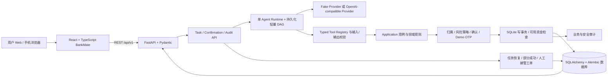
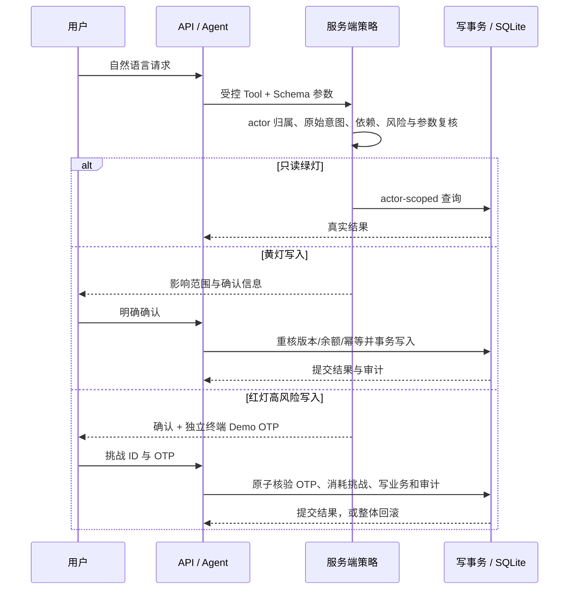
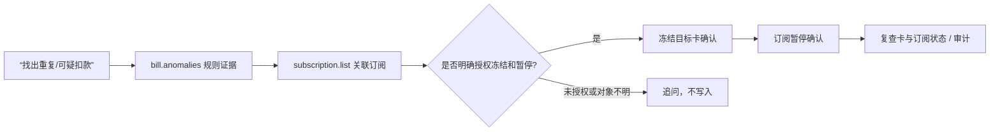
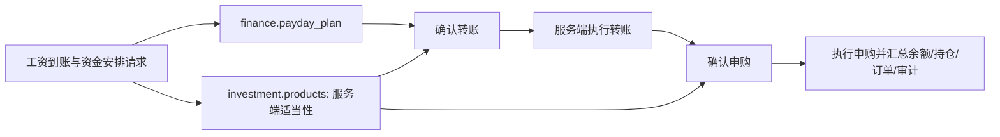
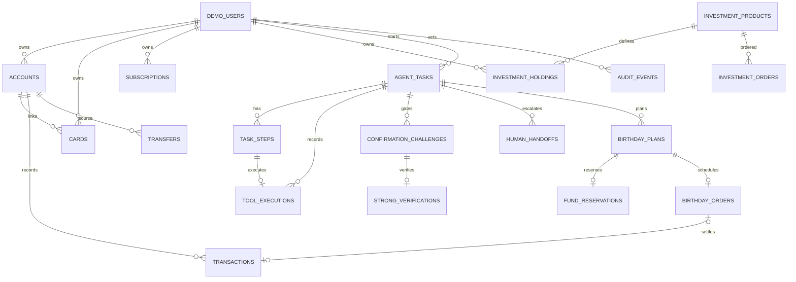

# BankMate 系统设计与比赛交付说明

> 本文描述 `feat/phase3-final-delivery` 当前代码。业务数据、账户、卡片、产品、订单和交易均为合成数据。真实模型评测和全量验收数字须以本文件更新日期对应的脱敏报告为准；未有报告的项目不得视为已完成验收。

## 1. 项目介绍

BankMate 是面向个人用户的模拟银行智能助手。用户用自然语言查询账户、办理日常银行操作或提出跨场景目标。系统把理解和规划交给受限的 Agent Runtime，把身份归属、资金计算、风险策略、确认和最终写入留在服务端。与普通银行 App 相比，BankMate 能把多步任务组织成带状态、依赖和确认点的流程；与普通聊天机器人相比，它展示的是数据库中实际发生的合成业务结果，而不是模型自由生成的“办理成功”。

产品目标覆盖六类场景：智能转账、账单分析、理财操作、银行卡管理、订阅与代扣、跨场景联动。BankMate 不连接真实银行、支付网络、商户或真实用户身份系统；所有金额仅在本地模拟账本内变化。

## 2. 六大场景与实际能力

以下“已实现”指当前代码存在相应业务路径；模型是否能在任意措辞下稳定选择工具，还要看本页“评测证据”。写操作全部通过 Agent Task 和服务端 ConfirmationChallenge 完成。

### 2.1 智能转账

| 功能                   | 用户表达示例                                        | 实际执行与结果                                                           | 模块与安全边界                                                                                     |
| ---------------------- | --------------------------------------------------- | ------------------------------------------------------------------------ | -------------------------------------------------------------------------------------------------- |
| 查询余额、收款人和记录 | “我的余额和最近转账是什么？”                        | 读取本人账户、可用余额及历史                                             | `transfer.accounts`、`transfer.payees`、`transfer.history`；按 actor 归属过滤                      |
| 普通转账               | “给小林转 200 元，备注午餐”                         | 按姓名或已保存手机号解析收款人，服务端换算为分、检查可用余额，确认后记账 | `transfer.create`；黄色确认；当日累计风险阈值触发红色 OTP；幂等、事务和审计                        |
| 定时转账               | “下周五给小林转 100 元”                             | 保存已确认的单次计划；本地 `simulate_due` 到期执行                       | `transfer.schedule`、`transfer.simulate_due`；执行日重新检查风险与资金，超过红色阈值则拒绝并留审计 |
| 取消定时转账           | “取消那笔预约转账”                                  | 仅取消本人且仍可取消的计划                                               | `transfer.cancel_scheduled`；确认后变更                                                            |
| AA 分账                | “创建火锅 AA 分账，总额 300 元，参与人为小王和小李” | 保存活动、总金额、参与人及模拟收款状态；可查询或请求收款                 | `transfer.split_create`、`transfer.split_collect`、`transfer.splits`；每笔写操作单独确认           |

### 2.2 账单分析

月度/年度收入、支出、净额、分类、趋势和交易明细都由后端对合成流水聚合。可按月份、分类、商户筛选；异常提示采用可解释的确定性规则，包括达到阈值的非住房单笔支出及同一账户、商户、金额、币种在同一 UTC 日重复扣款。提示只是规则命中，不是欺诈判定。

API：`GET /api/v1/transactions`、`GET /api/v1/bills/summary`、`GET /api/v1/bills/annual`。Agent Tools：`bill.transactions`、`bill.monthly_summary`、`bill.annual_report`、`bill.anomalies`。金额是整数分；前端展示金额但不得重算风险结论。

### 2.3 理财操作

用户可查看、比较模拟产品和资产；风险问卷由用户本人在前端填写，服务端保存风险画像。产品列表返回服务端适当性判断，Agent 只能在同一 Task 获得明确适配的产品结果后提出申购。申购、赎回会在确认后更新模拟账户、订单和持仓；赎回必须对应本人持仓。展示收益应标为模拟或说明性数据，不能暗示保证收益。

API：`GET /api/v1/investments/profile`、`GET /api/v1/investments/risk-assessment/questionnaire`、`GET /api/v1/investments/risk-assessment/latest`、`POST /api/v1/investments/risk-assessment`、`GET /api/v1/investments/products`、`GET /api/v1/investments/portfolio`、`GET /api/v1/investments/orders`。Agent Tools：`investment.products`、`investment.compare`、`investment.profile`、`investment.assessment_questions`、`investment.portfolio`、`investment.orders`、`investment.buy`、`investment.redeem`。

### 2.4 银行卡管理

| 功能                   | 当前结果                                                                          | API / Tool / 安全                                                                                                  |
| ---------------------- | --------------------------------------------------------------------------------- | ------------------------------------------------------------------------------------------------------------------ |
| 查询卡片、状态和申请   | 返回本人合成卡片及申请状态                                                        | `GET /api/v1/cards`、`GET /api/v1/cards/{card_id}`、`GET /api/v1/cards/applications`；`card.list/get/applications` |
| 申请模拟借记卡         | 确认后提交申请，状态为待本地模拟审核；不是真实发卡或授信                          | `card.apply`；模拟申请审核仅 development/test 使用本地操作员 CLI `apps/api/scripts/card_application_operator.py`   |
| 冻结、解冻、挂失、补卡 | 更新本人卡状态；挂失卡不可普通解冻，补卡生成新卡并保留旧卡关联                    | `card.freeze/unfreeze/report_lost/replace`；挂失和补卡需要确认与本地模拟 OTP                                       |
| 限额与线上开关         | `card.controls` 保存单笔/每日限额和线上支付开关；模拟商品消费在服务端真实执行拦截 | 每笔交易核验卡状态、线上开关、单笔额、UTC+8 自然日累计额及账户可用余额；高额设置可能升级 OTP                       |
| 模拟卡片消费           | 仅从固定合成商品目录购买并写入交易记录                                            | `card.catalog/purchase`；单笔高额消费需要确认与模拟 OTP；不访问真实商户                                            |

### 2.5 订阅与代扣

从合成交易识别周期订阅，读取状态、月度费用、下一扣款和提醒偏好。支持暂停、恢复、取消模拟自动续费。提醒是应用内合成通知，不代表已联系商户、扣款或发送短信。开发环境可启用数据库驱动提醒轮询器；提醒按账期去重，服务重启后由下一轮扫描恢复。

API：`GET /api/v1/subscriptions`、`GET /api/v1/subscriptions/reminders`、`POST /api/v1/subscriptions/reminders/refresh`、`PUT /api/v1/subscriptions/{subscription_id}/reminder-preference`。Agent Tools：`subscription.list/reminders/pause/resume/cancel`。写操作需要确认。

### 2.6 跨场景与生日计划

当前支持三条持久化依赖图，后端写入 Task 的 `workflow_plan` 并在工具分派入口再次检查依赖：可疑扣款处置、发薪日资金调度、生日预算/到期商品订单。任务可恢复；已成功工具不重放，部分成功仍展示已提交结果。任务步骤、确认、工具执行和审计由同一 Task 关联。

生日计划使用 `birthday.plan` 创建，确认后在 `fund_reservations` 中预留预算，不减少账户总余额，但从其他资金操作的可用余额中扣除。数据库唯一约束和写事务防止重复或超额预留。修改预算使用新确认；取消会释放剩余预留。持久订单由 `python -m finorch_api.birthday_scheduler` 周期扫描，扫描只将到期订单改为待用户确认，不会自动付款。用户明确请求购买后还要创建一笔新的 `birthday.order` 确认；确认时重新检查账户余额、卡片、商品金额与预留。付款成功才更新账户、交易、订单、计划和审计。此处采用模式 A（到期再次确认），没有通用预约扣款授权。

API：`GET /api/v1/birthday-plans`；创建、修改、取消和购买通过 Agent Task。Tools：`birthday.list/plan/order/budget_update/cancel`。后端确认详情包含生日日期、预算、预留额、商品、账户、卡片尾号、付款金额及领取方式。2026-10-26 浏览器联调已通过队友 `/showcase` 展示并完成生日预算预留与到期订单二次确认付款；Task 最终文案现在以实际已支付结果为准。高风险 OTP UI 有输入入口，但本轮没有提交验证码。

跨场景主要 Tools：`finance.payday_plan` 仅计算；它不会改资金。资金调度 DAG 先取得服务端资金规划和产品适当性结果，再确认转账，最后确认理财申购。可疑扣款 DAG 先读取异常与订阅证据，再逐笔确认冻结和暂停。异常规则不代表欺诈识别。

## 3. 总体架构

Web 只通过 API 读写，不直接使用 ORM。API 建立受控 Demo Actor 和请求上下文。Agent 只提议注册工具调用；Application 执行业务计算。服务端 Session/事务拥有提交与回滚边界。SQLite 是当前初期模拟环境；生产多实例扩展、真正银行接入和生产认证均未实现。

## 4. Agent 与 Workflow

### 4.1 职责划分

1. `AgentTask` 保存 actor、conversation、幂等键、请求摘要、状态和持久化计划。
2. 有界 Agent Runtime 调用选定 Provider，校验 tool name、call id、参数 JSON 和 Pydantic Schema。Fake Provider 用确定性规则方便离线演示；OpenAI-compatible Provider 支持 DeepSeek Tool Calling。Fake 模式不是 LLM 推理。
3. Typed Registry 只暴露当前注册的业务工具。未知工具、格式错误、重复工具调用和不允许的写提议会以真实错误终止，不执行任意代码。
4. 依赖图给出服务器认可的下一个就绪步骤。依赖不满足时禁止写工具；每次确认后从 TaskStep / ToolExecution / 业务状态恢复，并且只调度尚未成功的节点。
5. 每个写步骤先落工具提案与 ConfirmationChallenge，执行前重新核对 actor、参数摘要、资源版本、状态、可用资金和风险；成功才返回服务端业务结果。

### 4.2 状态和恢复

Task 状态包括 `pending`、`planning`、`awaiting_input`、`awaiting_confirmation`、`running`、`completed`、`failed`、`cancelled`。Task 下关联有序 `TaskStep`、持久化 `ToolExecution` 和零或多个确认挑战。失败的后续步骤不抹掉先前已提交的操作；前端应表述部分成功并允许读取任务详情。未执行的确认可取消；已成功业务操作不会因刷新或再次确认重放。

### 4.3 人工接管

用户主动请求人工处理，或满足服务端定义的不可继续/部分成功条件时，可为原 Task 创建 actor-scoped `HumanHandoff` 工单。工单记录原因、当前状态与模拟处理结论并留下审计。它只是本地演示受理记录，不是客服通知渠道，也不授予人工操作者资金授权。

## 5. 金融安全与写操作生命周期

风险策略：只读为绿灯；业务写操作至少黄灯，必须显式确认。`risk-v1` 对当日 CNY 转账累计超 ¥1,000、R4/R5 产品申购、挂失/补卡、超过策略阈值的银行卡控制设置，以及规定的高风险信号要求红灯确认加本地 Demo OTP。具体规则及版本随执行记录保存。已确认的预约转账执行日如果触发红灯，由模拟器拒绝执行并记录失败，而不是把旧确认当成 OTP。

OTP 绑定 actor、Task、确认挑战、参数摘要、工具版本、资源版本、风险策略版本和业务日，最长三分钟、最多五次尝试，只保存哈希。OTP 只能由本地验证终端/评测测试签发，模型和 Web 不可读取签发码。它不是真实 MFA 或身份认证。

系统进一步使用整数分金额、`BEGIN IMMEDIATE` 写事务、资源乐观版本、唯一幂等约束、状态检查、交易/余额一致性检查和追加式 `audit_events`。Prompt 或 Tool Result 中的数据被视为不可信；用户授权从原始任务请求复核，金额、风险和执行结果以服务端为准。安全熔断按 actor 的近期异常审计信号暂时限制写操作，保留读查询。数据库失败时，确认消费、资金状态、订单、Task 结果和审计一起回滚。

## 6. 三条跨场景演示流程

### A. 可疑扣款处置

每个对象各自确认；依赖数据从实际工具结果选择。提示只表明规则命中，不下欺诈结论。无明确写授权或无法唯一识别目标时停止，不产生业务副作用。

### B. 发薪日资金调度

资金计划、月度收支和建议预算为只读计算；转账和申购是两个独立确认节点。依赖图确保申购金额不超过计划及已核验产品适当性；转账失败时下游不可继续，余额不足或适当性变化由服务端拒绝。

### C. 生日预算与模拟商品预订

到期调度只把持久订单变成 `awaiting_confirmation`，不扣款。模式 A 要求新的用户请求和新的服务端确认；任何预算差异、订单失败或取消都会通过事务更新或释放剩余预留。开发者可用模拟时间触发；服务重启后按数据库状态重新扫描。

## 7. 数据模型与关系

金额以整数分和 `CNY` 存储，时间戳使用 UTC；生日及业务日历按明确时区处理。以下实体与表名取自当前 SQLAlchemy 模型；关联通过外键、唯一约束或显式 ID 维护。

核心业务表还包括 `payees`、`split_bills`、`split_participants`、`risk_assessments`、`card_applications`、`audit_events`、`subscriptions`、`transfers`、`investment_orders`。审计为通用追加事件，记录 `event_type`、actor/resource、request/task/tool execution、结果、时间和可选的前后状态摘要；不得写入密钥、完整 Prompt 或原始敏感载荷。

生日表：`birthday_plans` 保存 actor、账户/卡片、生日与购买日、预算、商品目录合计和版本；`fund_reservations` 保存总额、held/consumed/released 对账值；`birthday_orders` 保存模拟商户、商品、总额、领取信息、计划日期、状态及关联交易。保留总账户余额，预留额由 `available_balance_minor` 派生。

## 8. 三项可验证创新

1. **受控自主金融执行。** 不让模型直接写表，而是由工具 Schema、原始意图、风险策略、资源版本、用户确认和数据库事务共同决定能否执行。演示凭据是 Task、确认和审计记录，以及对应业务表的最终状态。
2. **可恢复的跨场景流程。** 一个自然语言目标可以串接账单、订阅、卡片、资金计划、转账和理财工具；服务端 DAG 持久化依赖，多次确认后续跑，不重放成功节点。演示凭据是任务计划、逐步确认卡、数据库业务结果和审计时间线。
3. **面向生活目标的预算预留。** 生日计划把预算从“口头提醒”推进到可用资金占用、订单时点提醒与第二次购买确认，同时提供取消释放和订单对账。演示凭据是余额/可用余额差异、预留记录、待确认订单与支付交易。它仍是模拟闭环，不连接真实商户。

## 9. 评测、质量与限制

本节将在 `phase3-final-dev-v2` 的 37 案例开发集、冻结后的 `phase3-final-holdout-v2` 25 案例独立留出集、后端全量 pytest、CI 和浏览器检查完成后，以脱敏报告数字填写。每项数字都需给分子/分母、日期、模型、案例集和失败分类；不能用调用成功代替业务成功，也不能把安全拒绝算作模型安全率。旧 `phase3-feature-holdout` 仅为历史结果，不能作为本轮未见留出结果。

当前已知设计边界：

- Demo Identity 和 OTP 都非生产认证；仅本地或受控比赛演示使用。
- 所有数据和资金流是合成数据，SQLite 面向单机演示，不等于生产账本。
- DeepSeek 用例是小规模、固定冻结案例；不能代表任意用户表达的成功率或统计显著性。
- 生日到期扫描由本地命令/计划任务运行；下单需重新确认，不提供静默自动付款。
- 订阅提醒仅为应用内合成提醒，不发短信或请求商户。
- 规则异常提示不是欺诈检测；收益和产品数据是模拟值。
- 本地卡片申请审核与人工接管没有正式客服、银行审批或多角色认证。
- 不提供生产部署、真实银行、真实支付、真实用户身份或跨设备授权。

## 10. 技术栈与运行

前端 React、TypeScript、Vite、Tailwind CSS；后端 Python、FastAPI、Pydantic、SQLAlchemy、SQLite、Alembic；测试 pytest、Ruff、ESLint、TypeScript、Prettier；OpenAPI 由 FastAPI/Pydantic 生成，前端类型经 `pnpm run api:types` 更新。真实模型通过 OpenAI-compatible Adapter 连接 `deepseek-flash`；Fake Provider 可离线运行。

Windows 初始环境、重置与本地启动见[开发指南](development.md)。开发者生日到期触发：`uv run --project apps/api python -m finorch_api.birthday_scheduler --now <含时区的时间>`。订阅提醒调度器只在 `development` 且 `FINORCH_SUBSCRIPTION_REMINDER_SCHEDULER_ENABLED=true` 时启动。Demo Reset 只作用于被允许的本地合成数据库路径；不得对未知或真实数据库执行重置。
