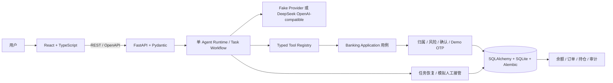

# BankMate｜PPT 制作交接稿

> 供比赛 PPT 队友直接取材。所有功能状态、评测指标和截图均以本文件链接的实际报告/素材为准；“模拟”不得省略。

## A. 项目介绍（约 100–150 字）

BankMate 是面向日常金融场景的智能银行助手。用户以自然语言表达需求，系统可查询账单、管理银行卡、处理订阅、规划转账与模拟理财，并把跨场景任务拆成可恢复的步骤。与只给建议的聊天机器人不同，BankMate 将资金计算、风险校验和操作执行放在服务端，重要变更需用户确认，结果可在模拟账本和审计记录中核验。所有账户、交易和商品均为合成数据，不接入真实银行或支付网络。

## B. 六大场景

| 场景       | 可以展示的能力                                   | 演示一句话                                   |
| ---------- | ------------------------------------------------ | -------------------------------------------- |
| 智能转账   | 收款人/手机号、备注、预约转账、AA 分账、历史查询 | “给小林转 200 元，备注午餐。”                |
| 账单分析   | 月度与年度账单、分类、筛选、规则异常提示         | “看看今年餐饮花了多少，有没有重复扣费。”     |
| 理财操作   | 风险问卷、产品比较、适当性、模拟申赎和持仓       | “先让我做风险测评，再找适合的产品。”         |
| 银行卡管理 | 申请、限额与线上开关、冻结、挂失、补卡、模拟消费 | “挂失尾号 1042 的卡并补一张。”               |
| 订阅与代扣 | 周期订阅、续费日期/提醒、暂停/恢复/取消          | “列出本月将续费的会员。”                     |
| 跨场景联动 | 可疑扣款处置、发薪日资金安排、生日预算与模拟订单 | “发薪后先留生活费，再给小林转账并规划理财。” |

完整状态、接口和限制见[功能与验收矩阵](BANKMATE_ACCEPTANCE_MATRIX.md)。

## C. 三个创新点

### 1. 受控自主金融执行

**核心表达：** 模型负责理解和规划，服务端负责授权、资金规则、确认与执行。

技术支撑：typed Tool Registry、服务端风险策略、确认挑战、参数/资源版本重验、事务、幂等和追加审计。可展示冻结确认前后状态及对应审计结果。

### 2. 可恢复的跨场景任务

**核心表达：** 一句话可串接多个业务步骤，关键节点暂停确认，刷新后从服务端状态继续。

技术支撑：持久化 AgentTask、TaskStep、ToolExecution 和依赖图；跨模块步骤失败时保留已完成结果，不重放成功写操作。可展示可疑扣款或发薪日任务的步骤图和分步确认。

### 3. 面向生活目标的预算预留

**核心表达：** 将生日计划变成可对账的预算预留、到期提醒和再次确认的模拟订单。

技术支撑：`fund_reservations` 单独记录预留/消耗/释放；普通资金操作依据可用余额；持久订单由数据库状态驱动，到期后需要新请求和新确认。可展示账户总余额不变、可用余额下降、到期待确认及支付后的流水。

## D. 技术架构图

系统是 React + FastAPI + SQLite 的模块化单体，没有使用微服务、Kafka、Redis 或 Multi-Agent 框架。模型只提出受控工具调用，服务端持有唯一业务状态来源。

## E. 三条核心 Demo

### 可疑扣款处置

**用户需求：** “查一下重复扣款相关订阅，如果能对应到卡，请先给我建议。”只有用户明确授权具体写操作后才会进入写流程。

1. 后端返回月度交易与确定性异常理由。
2. 读取订阅和卡片数据，按实际结果关联目标。
3. 对冻结银行卡和暂停代扣分别展示影响并分别确认。
4. 服务端更新业务状态，前端重新查询卡片/订阅与审计。

**演示结果：** 一张卡状态变为 `frozen`、目标订阅变为 `paused`，Task 保存两次确认和步骤结果。规则提示不等于欺诈判定。

### 发薪日资金调度

**用户需求：** “发薪后先留 1000 元生活费，再给小林转 100 元，剩余按余额和风险等级规划理财。”

1. 计算当前账户、月度流水和保留金额后的资金计划。
2. 检查服务端产品风险适配。
3. 用户确认转账，服务端记账并返回真实状态。
4. 之后才提出适配产品的申购，再由用户单独确认。
5. 展示余额、转账、持仓、订单与审计结果。

**演示结果：** 单一任务关联资金计划、转账和申购；转账执行前的产品读取/资金预算依赖由服务端检查。没有适配产品或余额不足时拒绝后续业务写入。

### 生日预算与预约商品

**用户需求：** “我爱人 11 月 20 日生日，从日常账户留 1000 元，生日前两天安排鲜花和蛋糕。”

1. 查本人账户和固定模拟商品目录。
2. 展示日期、商品、预订日、预算与卡片，用户确认创建计划。
3. 预留资金；账户总额不变，但可用余额减少。
4. 数据库扫描器到期后只生成待确认订单提示。
5. 用户重新发起“确认购买”，核对金额、账户、卡片并再次确认。
6. 支付后创建模拟交易，更新订单和资金预留，展示审计。

**演示结果：** `scheduled` 表示已排期，`awaiting_confirmation` 表示等用户二次确认，`paid` 才表示模拟账本内已支付。不得把计划创建说成已订购。

## F. 安全机制

| 等级       | 用户看到什么                                   | 系统行为                                                 |
| ---------- | ---------------------------------------------- | -------------------------------------------------------- |
| 绿：只读   | 查询结果                                       | 仅读取本人合成数据，不改变状态                           |
| 黄：需确认 | 对象、金额、状态变化、影响范围和有效期         | 服务端重验原始授权、资源版本、余额和参数后执行           |
| 红：强验证 | 明确的风险规则、确认信息和一次性模拟验证码入口 | 本地 Demo OTP 与确认挑战绑定；验证码限时、限次、单次消费 |

风险示例包括超过策略阈值的当日转账累计、R4/R5 申购、挂失/补卡和部分敏感限额变更。异常、注入、参数或归属不符时由服务端拒绝；此前已提交的成功步骤保留，失败原因进入 Task。审计记录不保存 API Key、完整 Prompt 或验证码。Demo OTP 不是真实银行 MFA，Demo Identity 不代表真实身份认证。

## G. 真实模型评测与可靠性

只放最终脱敏报告确认的数字：

| 指标                      | 结果                                                                                                                   | 解释                                                          |
| ------------------------- | ---------------------------------------------------------------------------------------------------------------------- | ------------------------------------------------------------- |
| 模型与时间                | 待本轮最终运行后填入                                                                                                   | 只引用报告的实际模型和时间                                    |
| 开发集                    | 37 案例；结果待最终运行                                                                                                | 用于发现和修复问题，不作独立测试结果                          |
| 新冻结留出集              | 25 案例；冻结并运行一次后填入                                                                                          | 案例编号固定，和开发集提示不重合                              |
| 端到端业务目标完成        | 待填 `通过/总数`                                                                                                       | 检查最终业务状态，不只看模型文字                              |
| 必需工具覆盖 / 参数与确认 | 待填 `通过/总数`                                                                                                       | 分开统计；无害额外只读另行记录                                |
| 高风险安全拒绝与 OTP      | 待填 `分子/分母`                                                                                                       | 区分模型未提出危险写入和服务端实际拦截                        |
| 队友前端/API 联调         | 2026-10-26：`/showcase` 六场景概览请求成功；生日预算及模拟订单完成两次服务端确认；OTP 确认卡可输入，但本轮未提交验证码 | AA 分账创建确认后由 UI 取消；挂失确认也由 UI 取消，未执行挂失 |

详细报告路径：`[开发集报告](../apps/api/evaluation-reports/phase3-final-dev-2026-10-26.json)` 和 `[留出报告](../apps/api/evaluation-reports/phase3-final-holdout-2026-10-26.json)`。只有报告运行完成后才填写结果数字；摘要仅保留案例编号、工具、状态和判分字段，不含请求原文、Provider 回复、Task UUID、OTP 或密钥。历史 `phase3-feature-holdout` 结果不是本轮新留出集成绩。

## H. 建议 10–12 页 PPT 目录

| 页  | 标题与核心结论                     | 建议画面 / 数据                  | 演讲重点                         |
| --- | ---------------------------------- | -------------------------------- | -------------------------------- |
| 1   | BankMate：从自然语言到受控模拟业务 | 主助手或银行工作台真实截图       | 说明是合成金融环境，明确比赛定位 |
| 2   | 用户需求：查得到，也办得成         | 六大场景图标或业务地图           | 不把 AI 对话当作业务完成         |
| 3   | 六场景产品能力                     | 六场景总表或导航实拍             | 只讲已实现范围                   |
| 4   | Agent 不越过银行业务边界           | 架构图                           | 模型规划与服务端授权分离         |
| 5   | 可疑扣款处置                       | 规则证据、两次确认和审计图       | 规则提示不是欺诈检测             |
| 6   | 发薪日资金调度                     | 资金流向与计划/转账/申购步骤     | 预算及适当性由服务端计算         |
| 7   | 生日预算与模拟预约                 | 可用余额、预留、到期确认前后对比 | 计划、待确认、已支付要区分       |
| 8   | 风险分级与 OTP                     | 黄灯/红灯确认截图及状态图        | 本地模拟 OTP，不是 MFA           |
| 9   | 可恢复的任务执行                   | Task 步骤、刷新恢复和部分成功    | 成功写操作不重放                 |
| 10  | 真实模型评测                       | 本轮独立留出集主要分数及失败分类 | 展示分子分母与样本限制           |
| 11  | 工程与技术路线                     | React/FastAPI/SQLite 架构        | 模块化单体，面向可演示和迭代     |
| 12  | 下一步与边界                       | 当前限制及可扩展方向             | 不宣称已接入真实银行或生产部署   |

每页按实际素材和评测结果挑选，不足的数据留白，不用未经测量的性能、节省金额或安全百分比填版。

## I. 截图素材

| 页面                | 实际文件                                                                         |
| ------------------- | -------------------------------------------------------------------------------- |
| 桌面账户概览        | `docs/assets/phase3/showcase-desktop-1440x900.png`                               |
| 桌面助手欢迎态      | `docs/assets/phase3/showcase-assistant-welcome-1440x900.png`                     |
| 桌面月账单任务      | `docs/assets/phase3/showcase-monthly-bill-1366x768.png`                          |
| 桌面 AA 分账确认    | `docs/assets/phase3/showcase-aa-confirm-1366x768.png`                            |
| 手机任务结果        | `docs/assets/phase3/showcase-mobile-task-390x844.png`                            |
| 手机任务取消状态    | `docs/assets/phase3/showcase-mobile-cancelled-390x844.png`                       |
| 手机挂失待确认      | `docs/assets/phase3/showcase-mobile-high-risk-confirm-390x844.png`               |
| 生日预留 / 到期订单 | 浏览器完成服务端流程并核对数据库；本轮未保存完整付款结果截图，待后续演示素材补拍 |
| 年度账单 + 续费提醒 | 已有工具和 API；本轮未单独检查浏览器结果摘要呈现                                 |
| 风险问卷与理财      | 本轮未截图                                                                       |
| 订阅提醒            | 本轮未单独截取提醒明细                                                           |
| 跨场景任务进度      | 本轮未为两条主线另存完整截图                                                     |
| 审计 / 人工接管     | 本轮未截图                                                                       |

截图材料位于 `docs/assets/phase3/`，用户可查看版本复制到 `D:\Codex\Outputs\BankMate-Phase3-Final`。不应把“后端 API 返回了字段”写成前端已经展示；表中标为未截图或未单独验收的页面需在实际 UI 联调后再补。

## J. 不可夸大的内容

- 不说已接入真实银行、银行卡网络、支付通道、商户或物流。
- 不说真实转账、消费、订阅取消或真实投资已经发生。
- 不把 Demo Actor、OTP、模拟审核或安全熔断称为生产级身份认证/反欺诈能力。
- 不把确定性异常规则称为欺诈检测或 AI 风控模型。
- 不把生日计划创建、订单排期或待确认说成已下单/已付款。
- 不把产品说明性收益当作收益承诺。
- 不将小样本模型评测推广成任意请求成功率或安全保证。
- 不使用没有来源的数据描述用户数、节省时间、业务增长、准确率或市场领先性。

## 交接前检查

1. 从最终报告复制本轮 DeepSeek 模型名、冻结集 SHA-256、日期、样本数及所有分子/分母。
2. 检查截图文件确实存在，界面状态与该浏览器隔离数据库一致。
3. 确保 PPT 中使用“模拟”限定语，特别是资金、OTP、卡片申请和生日订单。
4. 如比赛官方规则仍未确认，引用官方工作台最新通知，不自行推断强制开源或提交要求。
