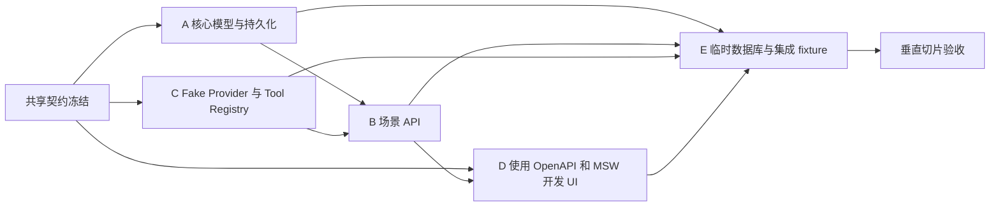

# Phase 1 实施计划（建议）

**编制日期：2026-10-18**

**状态：规划建议；Phase 1 尚未开始。**

本计划面向五条团队工作流 A–E，不代表人员分配。先做统一契约和可运行的第一条垂直切片，再并行扩展场景。Phase 0.5 只产生研究文档；本文件不修改现有 API、Agent 或 Workflow 契约，也不授权仓库公开。

## Phase 1 目标与边界

目标是形成可重复、可演示的本地模拟 Banking Agent 基础：六大场景按团队核实后的产品范围逐步落地，用户能看到服务端记录的任务进度，写操作由后端权限与风险策略保护，所有演示数据可重置和复现。

阶段边界：只用合成账户和模拟操作；不调用真实银行、支付、券商或订阅商户 API；不使用真实用户金融数据；任何 LLM Provider 都可保持 Fake 默认；不把比赛尚未核实的规则写为验收要求。赛事规则/作品权属/公开时间在官方确认前属于项目管理待办。

## 启动前共享门槛

在并行写业务代码前，团队共同确认并在对应 PR/ADR 固化：

1. Phase 1 场景优先级与第一条切片；本建议选择“冻结/解冻模拟卡片”。
2. OpenAPI 请求/响应、业务错误码、任务状态查询、工具 Schema 和生成类型更新方式。
3. Task/Step/ToolExecution/ConfirmationChallenge 最小字段与合法状态转换。
4. actor/资源归属的本地演示身份模型，安全等级与确认规则；不得让 Agent 或前端自行声明授权。
5. SQLite、SQLAlchemy、Alembic、合成 seed/reset 的落点和迁移负责人。
6. 每个模块的唯一责任文件路径与跨模块改动流程。Banking Core 负责人维护迁移，其他模块通过 Application/API 边界提出变更。

只冻结当前切片必需的接口，避免一次设计完六场景的所有表和接口。合同更新与第一个可运行 slice 应在同一短周期完成。

## 第一条垂直切片：模拟卡片冻结

推荐它作为首个端到端场景：它覆盖自然语言请求、工具 Schema、资源归属、确认、持久化状态、审计和前端状态刷新，且没有资金计算或外部集成。若团队因官方赛题核实结果调整首个场景，应先由产品/安全共同更新范围和验收，不需改动 Phase 0 基础架构。

### 建议执行序列

```text
用户请求
  -> API 建立 Task
  -> Fake/可选 Provider 返回受限计划
  -> Tool Registry 校验 card.freeze 输入
  -> 服务端验证 actor、卡片归属、状态和策略
  -> 保存绑定参数摘要与卡片版本的一次性确认挑战
  -> Web 展示待确认操作
  -> 用户确认
  -> 服务端重验 challenge、归属、状态版本和幂等键
  -> SQLite 单事务更新卡状态、消费 challenge、写 ToolExecution/Audit
  -> API 返回真实结果与 Task 状态，Web 重新读取
```

### 切片内需要真实工作的组件

- API：版本化请求/响应、OpenAPI Schema、错误码、request/task/tool IDs、确认接口。
- Application/Domain：卡片状态规则、归属检查入口、操作用例和允许的状态迁移；Agent 不直接访问数据库。
- Security：本地开发 actor 与 scope、策略级别、确认绑定/过期/重用拒绝；用 fail-closed 规则。
- Infrastructure：SQLite、SQLAlchemy、Alembic migration、固定卡片 seed 和安全 reset、单事务写入。
- Workflow/Audit：Task、Step、ToolExecution、ConfirmationChallenge 和不可伪造的服务端结果记录。
- Web：提出请求、查看实际计划/待确认影响、确认/取消、加载/失败状态、读取后端任务进度；类型由 OpenAPI 生成。
- 测试：工具/用例单测、API 确认流程测试、真实临时 SQLite 集成测试，断言数据库最终状态和审计。

Fake Provider 可以产生可预测计划；MSW 可以为前端开发模拟接口。它们不能代替后端授权/确认/持久化集成验收。任何兼容 LLM 调用都是可选配置，需单独的预算、超时和敏感信息检查。

### 可验收结果

- 合法的冻结/解冻只改变归属用户的模拟卡片；越权、无效状态、过期/篡改/重复确认均被服务端拒绝。
- 同一个幂等键和相同参数重试得到同一执行结果；相同键的不同参数明确冲突；并发重复请求没有第二次副作用。
- 卡片状态、确认消费、ToolExecution 和审计记录在成功路径可对照；数据库失败则不会留下假成功状态。
- 用户能从 Web 看见等待确认、执行成功、业务失败、网络错误和任务完成；UI 不以动画或模型回复显示伪执行成功。
- seed/reset 可在本地和 CI 重复运行；数据全为合成数据。
- CI 覆盖前端格式/lint/类型/build，后端 lint/test/OpenAPI 一致性和临时 SQLite 流程。

## A–E 五条工作流

职责是模块所有权建议，不绑定成员；每位贡献者在自己的模块内增加单测，并遵循根目录 [AGENTS.md](../../AGENTS.md) 和[协作规范](../collaboration.md)。路径是 Phase 1 计划落点；如果实际树有变化，先更新归属文档/PR，不要平行创建另一套同职责实现。

| 工作流                                 | 负责范围                                                                | 建议路径                                                                                                                                               | 交付与依赖                                                                                                         |
| -------------------------------------- | ----------------------------------------------------------------------- | ------------------------------------------------------------------------------------------------------------------------------------------------------ | ------------------------------------------------------------------------------------------------------------------ |
| **A. Banking Core & Database**         | 核心实体、规则、SQLite、SQLAlchemy、Alembic、migration、seed/reset      | `apps/api/src/finorch_api/domain/`；`application/banking_core/`；`infrastructure/persistence/`；`apps/api/migrations/`；`apps/api/tests/banking_core/` | 最先定义卡片实体/状态用例、事务边界和数据库 fixture；负责迁移冲突的串行合并。不得把 API/Agent schema 塞进 ORM 模型 |
| **B. Banking Business APIs**           | 场景 API DTO、路由、Application 用例适配、OpenAPI 变更                  | `apps/api/src/finorch_api/api/v1/scenarios/`；`application/scenarios/`；`apps/api/tests/api/`                                                          | 依赖 A 的用例契约和共享 API 决策；负责生成/校验 OpenAPI 与前端类型流程，不在路由重复业务规则                       |
| **C. Agent & Tool Orchestration**      | Provider 端口/Fake、单 Agent 有界循环、Tool Registry、Workflow 任务编排 | `apps/api/src/finorch_api/agent/`；`workflow/`；`apps/api/tests/agent/`；`apps/api/tests/workflow/`                                                    | 依赖 Tool Schema、Task/状态契约与 Security 提供的授权/确认用例；不直接写 DB、不直接调用场景 ORM                    |
| **D. Frontend & UX**                   | 首页到任务/确认 UI、任务状态与错误呈现、API 客户端及 mocks              | `apps/web/src/app/`、`components/`、`features/`、`lib/api/`、`mocks/`、`tests/`                                                                        | 契约冻结后可用 MSW 并行；使用生成类型；不自己推断余额、权限或执行状态，不维护接口类型副本                          |
| **E. Security, Testing & Integration** | 安全策略/审计接口评审、跨模块集成、威胁场景与 CI 质量门                 | `apps/api/src/finorch_api/security/`、`audit/`、`apps/api/tests/integration/`、相关 workflow                                                           | 不是全组负责人或唯一测试人员；模块所有者写单测，E 负责组合路径与安全负例。资金/权限 PR 需安全额外审查              |

以上目录目前可能不存在，属于目标责任范围；按实现需要创建，不要提前建空目录。Application 的跨域流程须只有一个权威实现：API 与 Agent 都调用相同用例，避免双写规则。

## 依赖顺序与并行策略



具体协作方式：

- A 是 migration 和核心持久化文件的唯一合并协调者；其他工作流通过小 PR 依次提出 schema 需求，避免同时改一份 migration。
- B 先基于已冻结 Pydantic DTO/OpenAPI 开路由；若 C 需要不同工具输入，B/C 一起修改契约并在同一 PR 更新类型，不各自定义同名接口。
- C 使用 Fake Provider、Tool Registry 和应用用例接口，可在 A/B 未完成时用窄 fake 开发；fake 与真实服务端执行结果必须区分。
- D 在 API schema 冻结后通过生成类型和 MSW 先完成 UI，不需要等待 LLM 或真实 DB；接口变化由契约 PR 重新生成类型。
- E 提供跨模块集成测试清单、模拟 actor 与负向安全用例；E 与各模块作者共同修复，不把安全责任外包给 E。
- 一个 PR 尽量只由一个工作流拥有；跨域改动在 PR 描述列明受影响模块、契约文件、迁移和测试，并请求相关 owner review。

## 后续场景实施顺序建议

首个卡片切片通过后，再按依赖和安全复杂度切成可交付小步；下表是工程建议，不是官方赛题优先级。

| 顺序 | 场景/能力      | 前置条件与最小输出                                                             |
| ---- | -------------- | ------------------------------------------------------------------------------ |
| 1    | 卡片管理       | 完成首条冻结/解冻垂直切片；再视范围加入模拟额度和消费控制                      |
| 2    | 账单分析       | 固定合成交易、后端聚合和可解释区间；先只读，金额汇总以确定性后端为准           |
| 3    | 智能转账       | 账本、币种精度、余额/归属、幂等和确认集成测试准备完毕后再做写操作              |
| 4    | 订阅与代扣管理 | 合成 mandate/subscription 状态、撤销确认和审计，不连接商户/支付网络            |
| 5    | 理财操作       | 固定虚构产品与价格；只做模拟订单、范围校验和明确确认，不作真实投资建议/交易    |
| 6    | 跨场景联动     | 前五类工具协议和可恢复单步骤任务稳定后，选择一条多步骤 demo，展示部分成功/失败 |

若官方规则核验要求另一优先级，由产品负责人更新此计划和范围，不将规则外推到其他年度/赛道。

## 阶段里程碑与退出条件

### 1A：契约和模拟数据底座

- 确认最小实体、migration、seed/reset、actor、安全策略和 API DTO。
- 生成 OpenAPI 和 TypeScript 类型可重复且无未审查漂移。
- A/E 验证临时 SQLite 生命周期；D/C 可并行做不依赖未冻结字段的 fake。

### 1B：首条安全写操作切片

- 完成卡片冻结/解冻工具、API、服务端确认/幂等/审计、任务状态和 Web 界面。
- 在 CI 以 SQLite 集成测试断言成功/拒绝/并发重试和失败回滚。
- 评审者可从全新 checkout 按 README 本地启动并重置数据。

### 1C：读场景与转账场景

- 先交付可重算的账单分析只读查询，再交付模拟转账；转账进入前要求账本 ADR 与安全负例测试完成。
- 每个场景独立 API、tool schema、测试、前端状态和文档，复用 Application/权限/审计边界。

### 1D：其余场景与跨场景演示

- 按官方规则核实结果和团队容量，逐个交付模拟理财、订阅管理和选定联动流程。
- 显示部分成功、失败恢复与取消边界；不宣称未实现的补偿或 exactly-once。
- 开源公开仍须由管理员按[私有优先策略](../development/public-release-checklist.md)手动执行发布审核，不由 Phase 1 自动更改仓库可见性。

## 质量门与完成定义

每个 PR 的范围要清楚，至少包含匹配的单元/集成测试、接口与文档同步、敏感数据检查。合并条件遵循仓库的私有仓库协作规则：CI 通过、至少一名其他成员 review；资金/权限/安全契约需要额外安全 review。管理员可在 GitHub 无强制 Branch Protection 时执行团队约定的人工流程。

每个场景达到可演示状态前，应能回答：用户请求会进入哪个 API/Task；实际调用了哪个注册工具；谁校验资源归属与权限；确认具体绑定什么；业务数据库改变了什么；重复/超时/取消会怎样；前端依据哪个服务端状态；如何从 seed 复现；测试如何断言结果真实。

## 比赛规则与发布待办

截至本文件核对日期，赛事公开页面无法提供完整规则，报名工作台在登录前也没有公开截止日期、提交物和开源条款；详见[研究索引](README.md#赛事来源及待核实事项)。在官方确认前，Phase 1 不把评分维度、六大场景、开源或日期写为强制验收。团队公开仓库或提交作品前应核实作品版权、所有成员授权、依赖/素材许可、Git 历史密钥和个人信息，并由仓库管理员手动决定公开。
