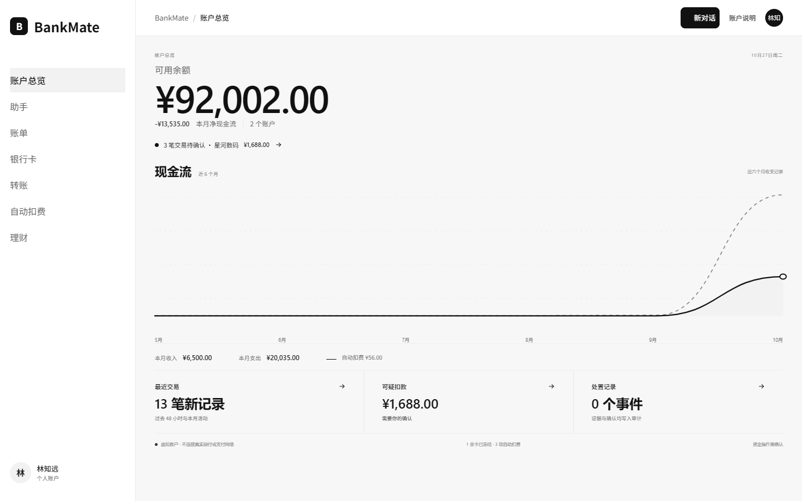

# BankMate 作品简介

BankMate 是一款面向个人用户的自然语言银行助手，支持账单分析、银行卡管理、订阅代扣、转账、理财及跨场景任务。用户可以查看账户信息、比较收支与产品，并在关键操作前核对影响和确认。当前账户、流水、卡片、产品及操作结果均为虚拟数据，不连接真实银行、支付网络或商户。

项目仓库：[Fire0206/finorch-banking-agent](https://github.com/Fire0206/finorch-banking-agent)（私有仓库）

账户总览围绕可用余额、收支、交易提醒和账户活动组织信息。
