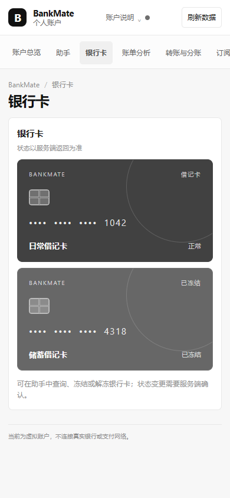

# BankMate 安全设计文档

核对日期：2026 年 10 月 27 日

## 安全边界

当前系统使用虚拟账户、合成流水和虚构理财产品，不连接真实银行、支付网络或商户。身份机制仅适用于本地竞赛环境；所有权限和操作决策在服务端执行。

| 边界 | 保护对象 | 设计要求 |
| --- | --- | --- |
| 身份与资源 | 用户、账户、银行卡、订阅、任务 | actor 来源受服务端控制；每次读取和写入检查资源归属 |
| Agent 与工具 | 工具列表、输入参数、工具结果 | 仅执行已注册工具；通过 Schema 校验；不执行模型生成的代码 |
| 高风险操作 | 转账、理财申赎、额度变更等 | 由服务端风险策略决定确认或强验证要求 |
| 数据库 | 余额、交易、订单、任务、审计 | 使用事务、外键、版本和唯一约束维持一致性 |
| 日志与模型上下文 | 账户标识、用户文本、密钥 | 不写入密钥、验证码或完整 Prompt；只传输完成任务所需的有限上下文 |

## 权限分级

- **绿色：只读。** 先通过身份和资源归属检查，再查询账户、流水、账单或业务状态。
- **黄色：用户确认。** 服务端展示具体对象、金额或状态变化、影响范围和有效期；用户确认后才执行写操作。
- **红色：确认并强验证。** 适用策略要求再次核验一次性验证码。当前验证码由本地命令行生成，只用于模拟流程，不是短信验证码、活体识别或生产级多因素认证。

风险等级由服务端策略计算，不由模型或前端决定。当前策略示例包括高额转账、R4/R5 理财产品申购、挂失补卡、较大幅度上调卡片限额和高金额模拟商品订单；具体阈值以服务端 risk-v1 规则为准。

## 确认挑战与资金保护

确认挑战绑定 actor、任务、工具名称及版本、规范化参数摘要、目标资源和版本、风险策略版本、有效期及幂等键。用户提交确认时，服务端重新检查挑战未过期且未消费，并重新验证权限、参数、资源版本、余额、限额和适当性。

确认消费、业务写入、任务结果与审计记录处于同一事务边界。重复确认不会再执行第二次副作用；参数被更改、资源版本变化或确认过期时拒绝执行。失败则回滚，不把未提交的业务结果显示为成功。

## Prompt 注入和工具调用

用户文本、商户名称、交易备注和模型输出都按不可信数据处理。模型只能请求 Tool Registry 中已注册的工具；服务端逐项校验工具参数、actor 权限和业务规则。模型不能自行选定用户身份、扩大权限、绕开确认、调用任意外部 API 或执行任意 Python。

真实 Provider 只用于自然语言理解和工具选择。余额、消费统计、产品适当性、权限判定、交易拦截和操作成功状态由服务端确定性计算。

## 审计和信息保护

审计事件记录操作类别、actor、资源、任务或工具关联、结果、时间和必要的前后状态摘要。审计不得包含 API Key、一次性验证码或完整 Prompt。错误响应使用统一结构和 Request ID；前端可以展示业务错误说明，内部错误细节不作为授权依据。

本地环境和自动化测试使用合成数据。配置云端模型后，用户输入和必要上下文可能发往所配置的模型服务；演示中不得输入真实账户信息或其他敏感数据。

## 运行保护与限制

当前有本地异常熔断规则，可在指定异常连续出现时暂时停止写操作；它不替代真实银行风控。SQLite 和单进程调度适用于本地展示与测试，没有完成生产环境的认证、部署隔离、分布式并发和灾备建设。

页面显示银行卡状态和可执行入口；实际状态变化仍需服务端确认并以接口返回结果为准。

进一步的测试结果、问题清单和风险处置见[安全自评报告](安全自评报告.md)。

