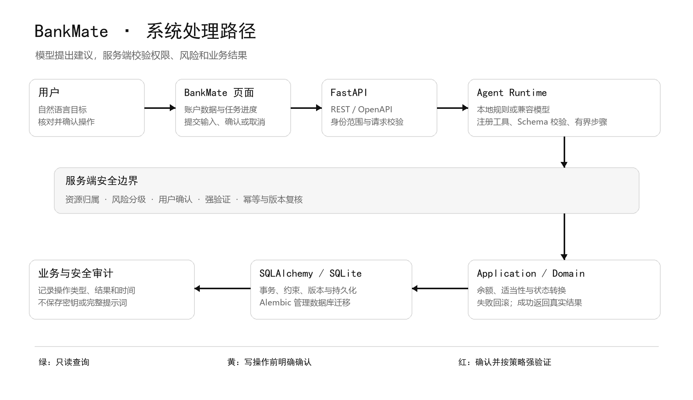

# BankMate 技术文档与安全自评

核对日期：2026 年 10 月 27 日

## 作品概况

BankMate 面向个人金融服务场景。用户可通过账户页面查看余额、收支、交易和业务状态，也可用自然语言提出查询或操作要求。系统覆盖转账、账单、理财、银行卡、订阅代扣和跨场景任务。当前运行于本地合成数据环境，不连接真实银行、支付网络或商户。

官网公开赛题要求至少覆盖六类核心场景中的三类，并鼓励完整覆盖。BankMate 已实现六类场景的合成数据业务流程；各项能力和限制见[答辩材料](答辩材料.md)。

## 系统结构

Web 页面负责展示账户信息、收集用户输入及呈现确认结果；FastAPI 接收请求并生成 OpenAPI 契约；Agent Runtime 只能选择注册工具并通过 Schema 校验；Application 用例和 Domain 规则负责余额、适当性、状态转换和业务结果；Security 边界负责身份范围、风险策略、确认、强验证和审计；SQLAlchemy、SQLite 与 Alembic 管理数据、事务和迁移。

模型可以提出工具调用，但不能直接改数据库、选择用户身份、提高自身权限或替用户确认。Fake Provider 用固定规则提供本地运行方式；配置 OpenAI-compatible Provider 时可以由语言模型选择工具。两种模式的业务写入都经过同一服务端校验和确认边界。

## 任务和操作流程

1. 用户请求进入服务端任务；系统根据已注册工具和依赖关系生成有界步骤。
2. 查询工具按当前 actor 的资源范围读取账户数据。金额、权限、风险和状态由服务端确定性逻辑计算。
3. 写操作先创建确认挑战，向用户展示对象、金额或状态变化、风险提示与有效期。
4. 用户确认后，服务端再次校验资源归属、参数摘要、资源版本、风险策略、余额和幂等键；需要强验证的操作还会校验本地一次性验证码。
5. 业务变化、确认消费、任务结果和审计在写事务内提交。失败时回滚；刷新后从服务端恢复任务，不重放已成功步骤。

跨场景任务使用持久化 Task、TaskStep、ToolExecution 和确认挑战表达执行顺序。每个写步骤独立确认；部分成功会保留已完成步骤和结果，后续步骤依据当前服务端状态继续或终止。

## 核心业务规则

| 范围           | 服务端处理                                                                                                 |
| -------------- | ---------------------------------------------------------------------------------------------------------- |
| 金额           | 以整数分保存，币种单独记录；不以浮点数作为账务值。前端仅格式化展示。                                       |
| 账户与交易     | 余额、收支汇总和交易记录从数据库读取或计算；转账与理财操作在事务内同步更新余额、流水、订单或持仓。         |
| 卡片           | 卡片状态、额度、线上支付开关和固定商品目录消费均在服务端校验；交易限制只作用于当前实现的合成卡片消费路径。 |
| 账单提醒       | 由金额阈值、重复交易等明确规则产生；提醒是核对线索，不是欺诈检测结论。                                     |
| 理财适当性     | 用户填写的风险问卷由服务端评分；申购前重查风险等级、产品等级与余额。产品、净值和收益均为虚拟信息。         |
| 定时与生日任务 | 本地调度器只更新模拟任务状态；生日订单到期后进入待确认状态，需用户再次授权，不会自动购买或扣款。           |

业务时间戳保存为 UTC；按自然日或生日处理时明确转换到业务时区。SQLite 是当前本地阶段的数据存储，并非生产多实例账本。

## 安全自评

### 权限分级

服务端采用 green / yellow / red 策略。该分级已用于后端决策；目前页面展示具体确认内容和额外验证要求，没有独立的红黄绿灯状态组件。

| 等级 | 当前策略                                                     | 实际边界                                                                                                                                                                             |
| ---- | ------------------------------------------------------------ | ------------------------------------------------------------------------------------------------------------------------------------------------------------------------------------ |
| 绿   | 只读查询在资源归属检查后执行，无写入副作用。                 | 不代表跳过身份或资源授权。                                                                                                                                                           |
| 黄   | 普通写操作先展示影响，再由用户明确确认。                     | 转账、分账、订阅变更、常规卡片状态变更和一般理财操作均受服务端确认约束。                                                                                                             |
| 红   | 高风险操作要求明确确认，并在适用策略下增加一次性本地强验证。 | 规则包括当日累计转账超过 ¥1,000、R4/R5 产品申购、挂失/补卡、上调单笔额度至 ¥1,000 以上或日额度至 ¥2,000 以上、目录消费超过 ¥1,000，以及生日订单超过 ¥10,000；策略按 `risk-v1` 执行。 |

目前的强验证码由本地命令行生成，验证码仅保存哈希，绑定确认挑战和参数，三分钟内有效，最多尝试五次。它不是短信、活体识别、银行 MFA 或生产级身份认证。

### 已落实的控制

- 身份由服务端本地开发配置提供；查询和写入均按 actor 检查资源归属。客户端传入的 user ID 或角色不能授权操作。
- 确认挑战绑定 actor、任务、工具及版本、参数摘要、目标资源版本、风险策略、幂等键和有效期；确认时重新验证这些条件。
- SQLite 写事务、唯一约束和资源版本保护确认消费、业务副作用及审计；重复确认不会再次执行。失败时业务状态、任务结果和审计一起回滚。
- Tool Registry 只允许已注册的工具；输入输出经过 Schema 校验，不执行模型生成代码或任意 Python。
- 交易备注、商户名和用户文本均作为不可信输入。未经用户明确授权的写操作由服务端拒绝；风险规则不会把异常扣款表述为已确认欺诈。
- 关键业务与安全决定写入追加式审计事件；审计不保存密钥、验证码或完整拼装 Prompt。任务恢复所需请求文本仍可能保存在本地数据库和浏览器会话中，因此只应输入虚拟信息。
- 五分钟内同一 actor 出现三次指定异常时，写操作暂时保持两分钟；只读查询仍可用。这是本地保护措施，不替代账户级风控。

### 自评结果与边界

2026 年 10 月 27 日运行的安全回归覆盖了安全评测、风险策略、强验证、身份范围、卡片控制、异常熔断和人工接管：**55 项通过**。这些是自动化回归结果和代码自查，不是第三方渗透测试、认证或独立人工安全审查。

仍需处理的风险：

1. 当前身份只适用于本地 development/test，真实账户登录、会话管理、设备绑定及生产授权尚未实现。
2. 一次性验证码来自本地终端，不具有真实第二因素的安全保证；页面本身也没有独立的绿/黄/红灯指示。
3. 如配置云端模型，用户输入及有限上下文会发往指定模型服务；只能使用虚拟数据，并需按团队要求审查服务条款和数据处理边界。
4. 异常消费依赖简单规则，可能漏报或误报，不能用于冻结真实账户或宣称反欺诈能力。
5. 当前 SQLite、单进程任务调度和本地熔断未经过生产负载、分布式并发或灾备验证。
6. 六大场景中的商品、产品、余额、流水及支付结果均为虚拟业务状态，不会代表真实存款、投资收益或商户交易。

## 评审重点对应

评审要点截图列出任务完成率 40%、安全合规性 30%、创新性及交互体验 30%。官网当前公开页确认“至少 3 个核心场景、鼓励完整覆盖六个场景”，但未在该页面独立显示上述权重；权重和更细分项在此标注为依据团队提供的赛事资料截图，正式提交前应在赛事工作台核对。

| 评审方向        | BankMate 的对应能力                                                          | 当前可核验内容                                                                                                                 |
| --------------- | ---------------------------------------------------------------------------- | ------------------------------------------------------------------------------------------------------------------------------ |
| 任务完成 40%*   | 关注任务完成、多步骤规划、工具调用正确性和系统完整性。                       | 六类业务工具、持久化任务、多确认续跑、失败和部分成功状态；可核对任务步骤、数据库状态、流水和审计。模型表现仍受表达和响应影响。 |
| 安全合规 30%*   | 关注诱导转账、信息窃取、越权和 Prompt 注入防护，以及敏感操作确认和风险提示。 | actor 资源范围、工具白名单、服务端风险策略、确认、强验证、幂等、熔断和审计；55 项安全回归通过，但没有独立认证或真实银行接入。  |
| 创新与交互 30%* | 关注场景新颖性、问题解决、对话轮次、追问能力、错误恢复、口语表达和范围兜底。 | 可疑扣款处置、发薪日资金调度、生日预算与二次确认；复杂表达、模型续跑和错误恢复仍有改进空间。                                   |

说明：权重及细分项来自团队提供的评审资料截图；官网页面未独立确认这些数字。

## 后续产品方向

以下方向是候选规划，不是现有功能承诺。

| 状态       | 能力                     | 用户价值与可复用基础                                               | 仍需补充                                                                          |
| ---------- | ------------------------ | ------------------------------------------------------------------ | --------------------------------------------------------------------------------- |
| Extendable | 月底余额与现金流预测     | 展示未来可用余额范围；可复用现有多月收支和账户余额。               | 定义预测周期、缺失数据处理、解释字段与新查询接口；先用可解释规则，再评估模型。    |
| Planned    | 财务健康评分             | 汇总现金流、储蓄水平、固定扣费与流动资金，并说明每项依据。         | 与团队确定评分规则、区间解释、异常处理及版本治理；不能只给无依据分数。            |
| Extendable | 订阅节省测算             | 展示暂停/取消后的月度和年度预计支出变化。                          | 复用订阅金额与周期；加入用户使用反馈、提醒偏好和节省口径。                        |
| Extendable | 资金流向与发薪日情景对比 | 用资金流展示转账、预留和投资计划执行前后的预计余额。               | 复用账户、账单和现有计划预览；增加多方案 API、风险说明和结果对比。                |
| Extendable | 理财配置情景             | 展示适当性依据、持仓分布和不同收益假设下的模拟区间。               | 复用风险问卷、产品和持仓；新增配置约束、收益假设及非保证收益声明。                |
| Extendable | 扣款证据链               | 把重复日期、金额、商户和订阅关联放在同一处，帮助用户判断下一步。   | 复用流水和账单规则；增加规则 ID、证据来源和关联强度，不能包装成欺诈结论。         |
| Extendable | 任务执行回放             | 用时间线展示步骤、等待原因、确认、恢复和部分成功结果。             | 复用 TaskStep、ToolExecution、Confirmation 与 Audit；新增聚合展示接口或前端映射。 |
| Planned    | 主动提醒与授权任务       | 在续费、账单异常或用户设置时间点提醒，并在授权范围内提出办理建议。 | 扩展事件触发、通知渠道、同意管理、撤销和服务端限频；当前提醒仅限本地任务。        |
| Planned    | 已执行操作的撤销/补偿    | 为可补偿动作展示撤销入口和资金影响。                               | 逐类定义反向业务操作、时效、原操作关联和再次确认；不能删除原流水或审计。          |
| Extendable | 人工接管                 | 复杂任务转交给可识别的客服或工作人员，并保留上下文和处理结果。     | 当前只有本地接管记录；需新增真实工单渠道、工作人员认证、权限和用户告知。          |

## 资料来源

- 赛事官网： [2026 深圳国际金融科技大赛](https://fintechathon.g-ican.com/)，2026-10-27 核对。官网公开了赛题方向、六类场景及赛程。
- 评审权重与材料条目：依据团队提供的赛事资料截图；官网页面未独立确认的提交系统细则、作品权属和授权条款仍待报名工作台核实。
- 产品界面参考：[Actual Budget 产品说明](https://github.com/actualbudget/actual/blob/master/PRODUCT.md)强调冷静、可信、实用的个人财务体验；[Actual Budget](https://github.com/actualbudget/actual) 与 [Firefly III](https://github.com/firefly-iii/firefly-iii) 均以账户、交易和收支组织日常任务。BankMate据此突出余额、流水与待处理事项，减少宣传语和装饰性组件；仅借鉴产品组织思路，不复制品牌或代码。核对日期：2026-10-27。
