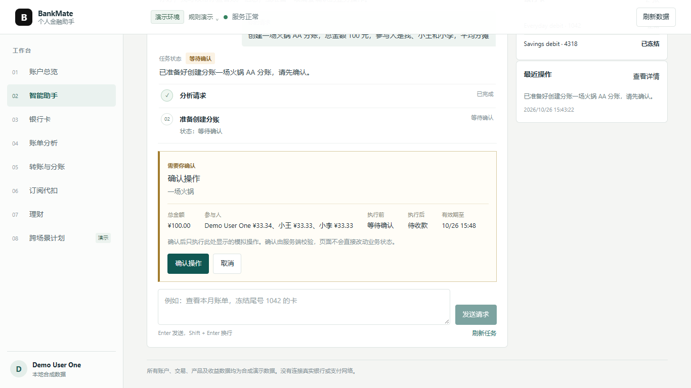

# BankMate 核心算法说明

## Agent 请求处理

Agent 负责理解用户请求并提出工具调用；服务端负责权限、金额、风险、业务规则和最终执行结果。

1. 模型返回回复、补充问题或工具调用请求。
2. Runtime 仅将请求交给已注册工具，并验证输入 Schema 与执行步数。
3. 查询工具按当前用户的资源范围读取数据；写工具由 Application 创建待确认操作。
4. 用户确认后，服务端重新校验权限、参数、资源版本、策略、有效期和幂等状态。
5. 业务数据、任务状态、确认消费和审计记录在事务中提交；工具结果以实际服务端执行结果为准。

## 多步骤任务

任务由 Task、TaskStep、ToolExecution 和 ConfirmationChallenge 记录。服务端保存任务状态和步骤顺序，前端通过 API 读取最新进度。

包含多个写操作的任务会在每个确认节点暂停。确认后从同一任务继续未完成步骤；已完成的写操作不会重复执行。任务失败时保留已完成步骤及其结果，未执行的后续步骤按依赖关系停止或等待处理。取消只影响尚未执行的操作。

## 业务计算与校验

| 场景       | 服务端计算与规则                                                                                                               |
| ---------- | ------------------------------------------------------------------------------------------------------------------------------ |
| 账户与转账 | 使用整数分计算余额；支持收款人、转账记录、定时转账和 AA 分账。执行前检查账户归属、可用余额及限额，并保存参与人金额和收付状态。 |
| 账单分析   | 按时间、商户和类别查询交易，汇总月度及年度收支；异常提示来自可解释的重复记录或金额规则。                                       |
| 订阅代扣   | 从交易周期识别订阅候选，展示周期费用和续费提醒；暂停、恢复或取消代扣需确认。                                                   |
| 理财       | 展示和比较模拟产品；服务端计算风险问卷结果，并校验用户等级、产品风险等级、最低金额和可用余额。                                 |
| 银行卡     | 支持申请、冻结、解冻、挂失补卡、限额调整及交易限制；按所属用户、卡片状态和服务端规则判断是否允许操作。                         |
| 跨场景任务 | Agent 组合已注册工具处理可疑扣款和发薪日规划等任务；按步骤确认、恢复任务并保存实际执行结果。                                   |

月度收支按所选期间的收入流水和支出流水汇总；净流入为收入减支出。前端展示服务端返回的金额和规则判定，不自行计算余额或权限结果。

## 幂等与异常处理

幂等键与操作对象及规范化参数绑定。相同幂等键和相同参数的请求返回原操作结果；相同键对应不同参数时由服务端拒绝。确认执行时，服务端在事务中消费挑战并检查资源版本，避免重复产生业务副作用。

模型超时、响应格式错误、参数无效、权限不足、余额不足、确认过期或资源版本变化均会产生对应的失败或等待状态，不会被报告为成功。

## 后续扩展方向

- 结合账户、交易和订阅数据展示财务健康概览、消费趋势和月底余额预测。
- 根据续费金额和使用情况估算订阅节省空间，并提供主动提醒。
- 为跨场景任务增加执行前后对比、步骤回放和可撤销操作。

这些方向可复用现有账户、交易、订阅和任务数据，后续需补充相应分析规则和接口。

用户在确认操作前可以查看分账金额、参与人、状态变化和有效期。
