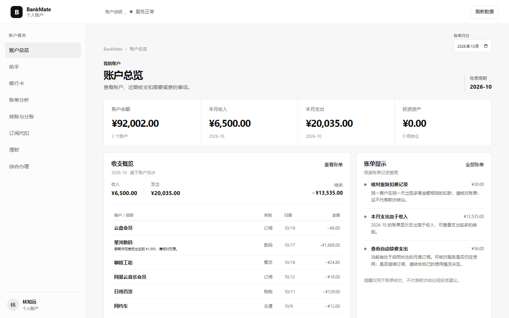
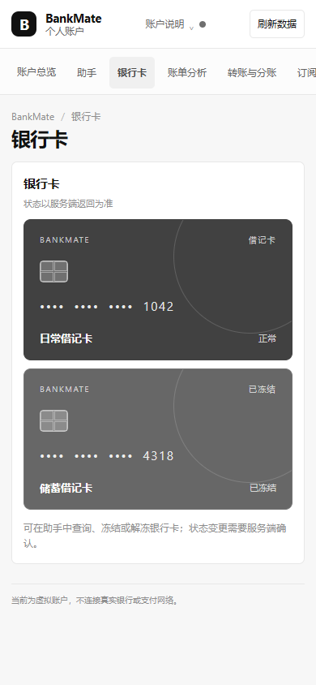

# BankMate 答辩材料

## 产品介绍

BankMate 把账户查询、银行卡、订阅、账单、转账和理财放在同一处。用户既可以直接进入业务页面，也可以说出一个目标；助手读取服务端记录、安排必要步骤，并在会改变状态或资金前展示对象和影响。确认后，页面展示数据库真实返回的状态和结果。

## 六类业务场景

| 场景       | 已实现功能                                                                                                  | 用户能看到的结果                                                                                |
| ---------- | ----------------------------------------------------------------------------------------------------------- | ----------------------------------------------------------------------------------------------- |
| 智能转账   | 按收款人创建转账、定时转账、取消计划、AA 分账及收付状态。资金写入需经服务端确认；定时业务由本地模拟器执行。 | 收款人、金额、账户、计划时间、分账参与人、执行状态、余额和交易记录。                            |
| 账单分析   | 月度与年度账单、分类统计、收支趋势、交易筛选和异常规则提醒。                                                | 收入支出、净现金流、分类、商户、日期、金额和提醒依据。重复扣款提醒不是欺诈结论。                |
| 理财操作   | 查看和比较虚拟产品、填写风险问卷、适当性校验、确认后申购/赎回、持仓及订单记录。                             | 风险等级、产品风险、最低金额、持仓、申赎记录和余额变化。虚拟收益不保证。                        |
| 卡片管理   | 查询银行卡、申请虚拟卡、冻结/解冻、挂失/补卡、修改额度与线上开关、固定目录消费拦截。                        | 卡片尾号、状态、限额、开关、申请/补卡状态和操作审计。卡片交易限制只适用于当前合成商品消费路径。 |
| 订阅代扣   | 从合成交易识别订阅，查看周期与下次扣款，设置提醒，确认后暂停/恢复/取消。                                    | 商户、金额、周期、下次日期、月度合计、提醒状态和变更结果。                                      |
| 跨场景联动 | 可疑扣款处置、发薪日资金调度、生日资金预留和到期订单二次确认。                                              | 多步骤进度、确认节点、部分完成结果、余额与持仓变化、审计摘要。                                  |

## 安全与权限

团队提供的赛事评审资料截图将安全要求概括为“低风险自动、一般风险确认、高风险强验证”。BankMate 的服务端风险策略按这一思路分级：

- **绿色：** 经过资源归属检查的只读查询可直接返回。
- **黄色：** 普通写入先展示对象及影响，由用户明确确认。
- **红色：** 高风险写入需明确确认，并按规则增加本地一次性强验证；如当日累计转账超过 ¥1,000、R4/R5 产品申购及若干敏感卡片操作。

目前这是服务端权限策略；网页显示确认内容与额外验证要求，尚未把等级绘制成独立红黄绿灯组件。强验证码由本地终端生成，不是银行短信或生产级 MFA。

所有金额、余额、权限、适当性、状态转换和执行结果由服务端校验；Agent 只能提出注册工具调用。确认挑战具有参数和资源版本绑定、有效期与幂等保护。写操作与审计在事务中提交，失败不会被页面当作成功。交易提示只用于核对，不宣称完成欺诈识别。详细边界和 55 项安全回归结果见[技术文档与安全自评](技术文档与安全自评.md)。

## 现场体验流程

### 可疑扣款处置

用户提出检查某笔重复扣款后，BankMate 展示商户、金额、日期和规则依据；再读取对应订阅和银行卡。用户分别确认银行卡冻结或订阅暂停。每一步完成后，页面重新读取服务端状态，并显示可追溯记录。若证据不足，系统请求补充信息或停止写入。

### 发薪日资金安排

用户说明收款人、转账金额和想保留/投资的金额后，系统先读取余额、账单和产品适当性，再给出只读计划预览。转账与理财申购是不同的确认节点。确认后的余额、交易、订单和持仓均以服务端响应为准。

### 生日预算安排

用户可以设定生日日期和预算；系统确认后创建资金预留。到达计划日期后只进入待确认状态，不会自动下单。用户重新查看商品和金额并再次确认后，才执行本地合成订单。

## 当前边界与后续方向

现有业务均使用虚拟数据，没有真实登录、银行转账、商户预订、理财产品或客服队列。自然语言工具选择依赖当前 Provider，复杂说法可能需要澄清；已执行任务与金融状态由服务端保存。可扩展的功能方向包括：

- **财务健康与现金流预测：** 从收入、支出、固定扣费和可用余额整理评分或月底余额区间；需要新增评分依据、预测规则和服务端字段。
- **订阅管理建议：** 根据周期与扣款金额估算年度支出和可能节省额；结合用户的使用反馈，避免替用户判断“浪费”。
- **资金规划与情景比较：** 将余额、账单、转账、预留资金和理财安排画成资金流，比较不同金额方案；可复用现有发薪日只读计划预览。
- **理财情景说明：** 解释风险等级、产品适配依据和不同收益假设下的模拟变化；需要新增配置模型，模拟结果不能当作保证收益。
- **扣款证据与任务回放：** 将账单规则、关联订阅、用户确认、执行结果和审计整理为时间线；异常规则只能提示核对，不能声称发现欺诈。
- **主动提醒、撤销和人工接管：** 当前有本地续费提醒与接管记录。真正通知、自动化授权、已执行操作的补偿撤销和客服转接还需事件渠道、权限与相应业务规则。

详细状态、复用数据和后端依赖见[技术文档与安全自评](技术文档与安全自评.md)。

## 赛事信息与核实范围

官网当前要求国内 AI 赛道至少覆盖六类场景中的三类，并鼓励覆盖全部六类；赛程列出的作品提交截止日期为 2026 年 11 月 2 日。核对日期：2026-10-27，最终以官网和报名工作台通知为准。

团队提供的评审资料截图列出任务完成率 40%、安全合规性 30%、创新性及交互体验 30%，并强调权限分级、Prompt 注入防护、操作审计、异常熔断、任务 DAG 和人工接管。官网页面未独立展示这些权重，作品权属及授权范围也需在报名工作台确认。

资料截图列出 200 字以内作品简介、架构/算法/安全文档、作品信息和安全自评；答辩 PPT 与视频时长以报名工作台为准。本组已整理三份 Word 材料，尚未制作 PPT 或视频。

**项目仓库：** [Fire0206/finorch-banking-agent](https://github.com/Fire0206/finorch-banking-agent)（私有）

**官网：** [2026 深圳国际金融科技大赛](https://fintechathon.g-ican.com/)　**报名工作台：** [apply.g-ican.com](https://apply.g-ican.com/)
