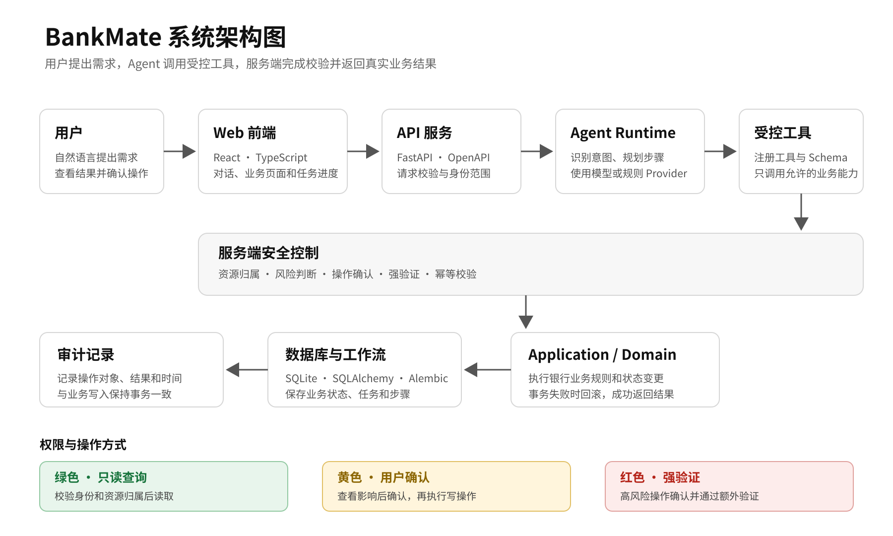
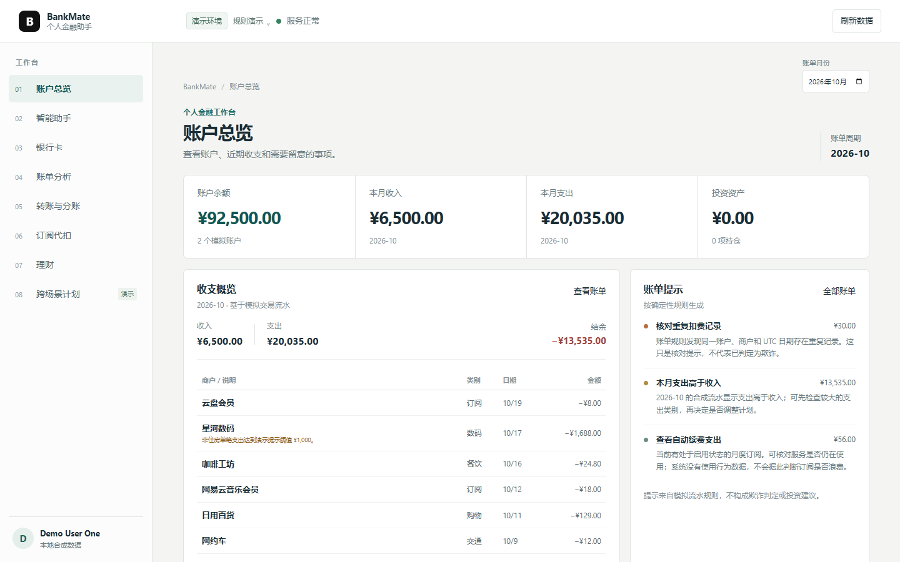

# BankMate 系统架构图

## 系统架构图

## 系统组成

BankMate 采用 React 与 FastAPI 构建模块化单体。前端负责交互和任务展示；API 层负责请求校验与标准响应；Application 和 Domain 层执行业务流程与规则；Infrastructure 层管理数据库、事务和迁移。Agent 通过受控工具调用业务用例，不直接访问数据库。

| 模块                 | 主要职责                                         | 技术                                            |
| -------------------- | ------------------------------------------------ | ----------------------------------------------- |
| Web                  | 页面展示、用户输入、任务状态与操作结果           | React、TypeScript、Vite                         |
| API                  | 请求校验、身份范围、错误响应和接口定义           | FastAPI、Pydantic                               |
| Agent                | 识别用户意图、选择已注册工具、推进任务           | OpenAI-compatible Provider、Typed Tool Registry |
| Application / Domain | 执行业务用例，校验金额、权限、风险和状态变化     | Python                                          |
| Security             | 资源归属、风险策略、操作确认、强验证、幂等和审计 | 服务端策略与事务                                |
| Infrastructure       | 数据持久化、事务、约束和数据库迁移               | SQLAlchemy、SQLite、Alembic                     |
| Workflow             | 保存任务、步骤、工具执行和确认状态               | REST API                                        |

## 操作流程

1. 用户通过页面提交自然语言请求。
2. API 根据服务端会话确定操作身份，并完成请求校验。
3. Agent 从已注册工具中选择操作，服务端校验工具参数与资源归属。
4. 查询操作返回业务数据；写操作生成待确认内容，等待用户授权。
5. 用户确认后，服务端再次检查权限、参数、资源版本、有效期和幂等状态。
6. Application 在数据库事务中更新业务数据并记录审计事件。
7. 前端从服务端读取任务及业务资源的最新状态。

## 数据与接口

- 当前账户、交易、卡片、订阅、理财产品和操作结果均为虚拟数据。
- 金额以整数最小货币单位保存，并明确记录币种；业务时间戳使用 UTC。
- API 采用 `/api/v1/` 版本路径。FastAPI/Pydantic 生成的 OpenAPI Schema 是接口定义来源，前端类型由此生成。
- 前端与 Agent 通过 API 和 Application 用例访问业务能力，不直接操作 ORM 表。

