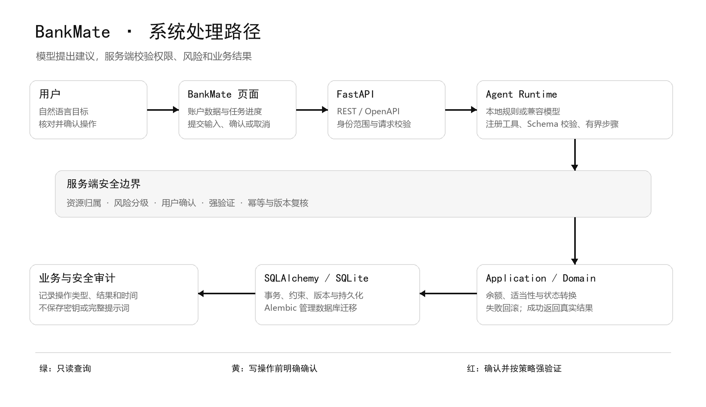

# BankMate 系统架构图与说明

核对日期：2026 年 10 月 27 日

## 系统架构图

## 架构说明

BankMate 采用 React 与 FastAPI 组成的模块化单体。前端负责页面展示、收集用户输入和呈现服务端任务状态；API 层负责请求验证、模拟身份上下文和标准响应；Application 与 Domain 负责业务用例及规则；Infrastructure 负责数据库、事务和迁移。Agent 通过受控工具调用 Application，不直接访问数据库。

| 模块                 | 主要职责                                                                              | 当前技术                                                       |
| -------------------- | ------------------------------------------------------------------------------------- | -------------------------------------------------------------- |
| Web                  | 账户、交易、银行卡和任务状态的用户界面；提交请求、确认或取消操作；按 API 返回刷新数据 | React、TypeScript、Vite                                        |
| API                  | REST 请求校验、身份范围、错误响应和 OpenAPI 契约                                      | FastAPI、Pydantic                                              |
| Agent                | 调用模型提供方、选择已注册工具、校验参数并推进有界任务                                | Fake Provider、OpenAI-compatible Provider、Typed Tool Registry |
| Application / Domain | 执行确定性用例，计算余额、收支、额度和适当性，校验状态转换                            | Python                                                         |
| Security             | 资源归属、风险策略、确认挑战、强验证、幂等和审计                                      | 服务端策略与事务校验                                           |
| Infrastructure       | 数据持久化、事务、外键约束和数据库迁移                                                | SQLAlchemy、SQLite、Alembic                                    |
| Workflow             | 持久化任务、步骤、工具执行、确认及恢复状态                                            | REST 查询任务进度                                              |

安全策略横跨 API、Agent、Application 与持久化写入路径。模型输出只是工具调用建议；最终权限、资金、限额和业务状态均由服务端判断。

## 一次操作的数据流

1. 用户在 BankMate 页面输入自然语言，或直接打开一个业务页面。
2. Web 将请求发送到版本化 REST API。API 从服务端模拟会话确定 actor，不采用客户端任意提交的用户或角色作为授权依据。
3. Agent Provider 返回普通文本或工具调用建议。Tool Registry 仅接受已注册工具，并验证工具名称、参数 Schema 与调用步数。
4. 查询工具按 actor 的资源范围读取数据。写工具先进入风险策略和确认流程，不在模型提出请求时直接修改业务状态。
5. 用户查看服务端生成的操作对象和影响并确认。服务端再次验证权限、参数摘要、资源版本、策略版本、有效期、幂等键及适用的强验证。
6. Application 在明确的数据库事务内写入业务状态与审计记录。失败时回滚，不返回虚假的成功结果。
7. Web 查询任务及相关业务资源的最新状态，并展示服务端返回的数据。

## 数据与接口边界

- 数据库包含虚拟用户、账户、交易、银行卡、订阅、理财、转账、Agent 任务和审计等数据。不同业务数据由相应 Application 用例读写。
- 金额以整数最小货币单位保存，币种明确记录；业务时间戳采用 UTC。
- SQLite、任务调度和模拟身份仅用于当前本地竞赛环境，不代表生产多实例或真实银行连接。
- API 采用 /api/v1/ 路径和 FastAPI/Pydantic Schema。OpenAPI 是接口事实来源，前端类型由仓库的生成流程更新。
- 前端和 Agent 不直接操作 ORM 表。新增业务先定义 API Schema 和 Application 用例，再由相应模块实现并更新接口类型。

## 运行和验证入口

环境初始化、启动命令、Seed/Reset、安全边界及测试命令集中维护在 README 和 docs/development.md。架构调整应同步更新此图及相关 ADR。

资料来源：[2026 深圳国际金融科技大赛官网](https://fintechathon.g-ican.com/)，2026 年 10 月 27 日核对。官网公开赛题说明至少覆盖六类核心场景中的三类，并鼓励覆盖全部六类。
